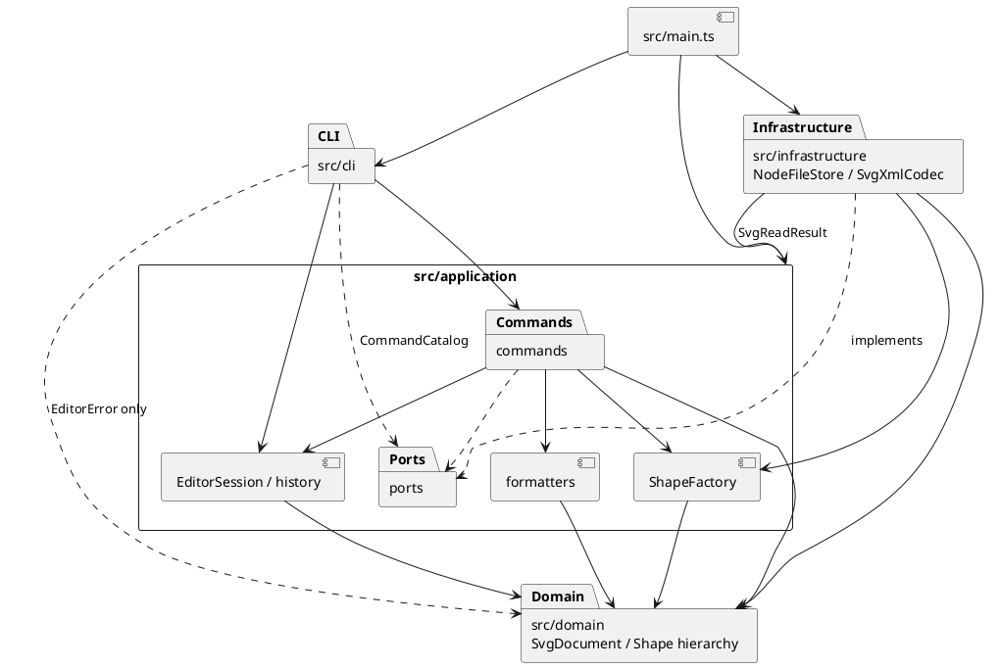

# SVG CLI 编辑器项目报告

作者：周乐涵。课程：软件设计，PJ1 Phase 1。文档整理日期：2026-10-18。

本项目根据 [`phase_cli_1.md`](../phase_cli_1.md) 实现 TypeScript 命令行 SVG 编辑器，支持六种内置图形、十九条命令、嵌套分组、撤销重做及 SVG 文件读写。[根 README](../README.md) 提供运行方法和命令说明，[验收记录](ACCEPTANCE.md) 保存已执行的检查、学生反馈和复现步骤。

功能检查和文档审阅已完成。2026-10-18，学生批准再次按课程要求核对，无误后提交、推送并创建 `final` 标签。前五阶段保留独立提交，第六阶段包含完整题目会话、验收材料及本报告；最终版本以 [`final` 标签](https://github.com/leoh4mster/svg-editor-cli-pj1/tree/final) 标识。

## 1. 架构方案

### 1.1 模块划分与职责

项目将终端交互、用例组织、图形业务和外部格式分开。领域对象持有约束和行为，命令组织操作，文件系统和 XML 库通过应用端口接入。

| 模块 | 职责与主要类 |
| --- | --- |
| `src/cli/` | `Cli` 处理逐行输入、提示符及统一错误；`CommandLineParser` 处理引号、转义和整行注释；`CommandRegistry` 保存命令目录并分发命令 |
| `src/application/` | `EditorSession` 管理当前文档、保存路径和编辑事务；`CommandArguments` 转换参数；`ShapeFactory` 将 CLI 参数或 SVG 属性转换成图形；`SvgReadResult` 封装导入结果和警告 |
| `src/application/commands/` | 每条命令一个类，提供语法、说明和统一执行入口；可撤销编辑继承 `EditCommand` |
| `src/application/history/` | `HistoryEntry` 私有保存编辑前后快照；`CommandHistory` 管理 undo/redo 两栈及文档命令后的历史禁用状态 |
| `src/application/formatters/` | `TreeFormatter`、`ShowFormatter` 从领域接口生成结构树和属性文本，不执行终端 IO |
| `src/application/ports/` | `CommandCatalog`、`TextFileStore`、`SvgCodec` 定义应用需要的命令目录、文本文件及 SVG 转换能力 |
| `src/domain/` | `SvgDocument` 管理画布、全局 ID、父级索引、有序结构和受控修改；`NumericValue` 统一数值约束；`EditorError` 表达可报告的错误 |
| `src/domain/shapes/` | `Shape` 与 `Rect/Circle/Ellipse/Line/Text/Group` 封装图形状态、几何校验、属性白名单、克隆、变换和容器行为 |
| `src/infrastructure/` | `NodeFileStore` 实现文件读写；`svg/SvgXmlCodec` 实现 XML 解析和序列化；`SvgElement` 封装基础设施内部的 XML 过渡树 |
| `src/main.ts` | 创建会话、命令、工厂与适配器，集中注册命令并注入依赖 |
| `test/`、`examples/` | 保存领域、应用、文件系统与真实 CLI 测试，以及各阶段和完整题目会话脚本 |

以下 PlantUML 包图中的箭头表示允许的依赖方向；具体类和端口的约束见第 1.3 节。



### 1.2 设计模式及实现

#### Command：统一命令入口

[`Command`](../src/application/commands/Command.ts) 定义 `execute(args, session)`、语法和说明。CLI 只负责解析、查找和调用命令对象；十九条命令的业务行为分别封装在命令类中，不写入 REPL 的条件分支。

十条编辑命令，即 `create/delete/move/scale/set/group/ungroup/addto/front/back`，继承 [`EditCommand`](../src/application/commands/EditCommand.ts)。统一入口调用 `EditorSession.executeEdit`，一次成功执行就是一个撤销单元。文档类命令、显示命令及 undo/redo 使用各自会话入口，遵守题目规定的历史规则。`HelpCommand` 依赖 `CommandCatalog`，无须反向依赖 CLI 的具体注册表。

#### Composite：统一叶子与容器

[`Shape`](../src/domain/shapes/Shape.ts) 提供统一的 `children/walk/summary/details`、`clone/moved/scaled/withAttribute/withChildren` 及 SVG 属性接口。五种叶子和 [`Group`](../src/domain/shapes/Group.ts) 通过多态实现这些行为：容器递归移动、缩放子孙，删除容器删除整棵子树；格式化器和 SVG 编码器递归消费统一接口，不逐个判断类型。

图形几何和显式属性由对象封装，编辑返回独立副本。`SvgDocument` 统一管理挂接、替换、删除及索引，已归属图形的结构修改必须持有文档私有令牌，防止绕过文档直接改子节点。数组和属性映射对外提供防御性副本，避免外部引用改坏内部结构。

#### 快照历史：先验证，再提交

[`EditorSession`](../src/application/EditorSession.ts) 先克隆当前文档，在草稿上执行编辑；成功后复制提交结果并准备历史快照，最后切换当前文档和更新历史。递归编辑即使在后续子孙处溢出，也不会只移动前几个节点。历史恢复使用独立副本，保留的旧文档或草稿引用不能污染当前状态及快照。

结构调整还在领域层构造完整的局部文档，验证层级、唯一 ID、父级索引和归属后才接管，因此直接调用领域结构 API 失败也保持原状态。快照优先保证层级、顺序和删除内容准确恢复；每个历史项保存编辑前后两份完整文档，空间随文档大小增长。本次未实现差量历史或大文档性能优化。

#### 工厂与适配器：集中构造，隔离 IO

[`ShapeFactory`](../src/application/ShapeFactory.ts) 的同一注册表保存六类型的构造配方、参数语法和 SVG 几何字段。`create` 与 `fromSvg` 共用类型查找；具体图形负责最终几何约束。SVG 适配器不增加第二套标签到图形类的分支。

`ReadCommand`、`SaveCommand` 依赖 `TextFileStore` 和 `SvgCodec`，由 `main.ts` 注入实现。读取完成 UTF-8 解码、XML 解析、ID 检查及领域构造后才替换当前文档，补 ID 警告也在成功后输出；保存先生成和验证完整 XML，文件写入成功后才更新路径及历史。`NodeFileStore` 在目标同目录完整写入临时文件后重命名替换，保留已有普通文件权限和符号链接引用，失败时清理临时文件，避免半份输出覆盖原文件。

按题目要求，允许的两处名字分派均标为后续重构点：

| 分派位置 | 当前实现 | 待重构方向 |
| --- | --- | --- |
| [`CommandRegistry.execute`](../src/cli/CommandRegistry.ts)：命令名 → 命令对象 | 唯一命令名分派，**待重构** | 将来可由命令提供者注册，复用现有 `Command` 接口 |
| `ShapeFactory.requireRecipe`：类型名 → 构造配方 | CLI/SVG 共用的唯一类型名分派，**待重构** | 将来引入 `ShapeProvider`，扩展复合图形及插件 |

本次集中注册即可满足范围，不预先实现插件发现、动态加载或服务定位器。

### 1.3 依赖方向规则

| 模块 | 允许依赖 | 约束和理由 |
| --- | --- | --- |
| `domain` | 领域内部类型及语言标准能力 | 不导入应用层、CLI、文件系统和 XML 库，使业务规则可独立验证 |
| `application` | 自身模块、`domain` 和应用端口 | 不导入 `cli/infrastructure` 的具体实现；命令组织用例，领域维护约束 |
| `cli` | 应用会话、命令接口及 `CommandCatalog`；共享 `domain/EditorError`；Node.js 终端和流接口 | 不依赖具体图形或直接修改文档，终端交互留在外层 |
| `infrastructure` | 应用端口、`ShapeFactory`、`SvgReadResult` 和领域模型；Node.js 文件/路径/加密库、`saxes/xmlchars` | 负责格式与 IO 适配，应用和领域不得反向导入它 |
| `main.ts` | 上述全部模块 | 仅承担对象装配和注册，不放图形业务规则 |
| `test` | 被测模块及测试所需标准库 | 通过测试替身验证文件错误，并以真实 CLI 子进程验证整体行为 |

这些规则使更换终端入口、文件后端或 XML 解析库时，图形行为和历史规则仍可复用。实际 import 的核对结果见第 3 节。

### 1.4 变化点假设与取舍

| 可能变化的地方 | 预留方式或暂不实现的原因 |
| --- | --- |
| 新增命令或 GUI/agent 入口 | 命令与 CLI 分离，语法和说明由目录统一提供；未来入口可复用应用用例 |
| 新增图形、复合图形或插件 | `Shape` 多态、Composite 和集中工厂提供扩展边界；题目的 `box` 属后续阶段，本次不实现 |
| 扩大 SVG 支持范围 | `SvgCodec` 隔离 XML，额外属性随图形保留；当前不能解释的语义明确拒绝，避免静默丢失 |
| 更换文件存储 | `TextFileStore` 隔离本地文件系统，不让命令依赖 `node:fs` |
| 改变撤销存储策略 | 历史集中在 `application/history`；有性能需求时可替换为差量，当前先保证恢复正确性 |
| 扩展属性与数值规则 | 几何和白名单由图形类负责，数值解析统一委托 `NumericValue`；避免将规则复制到各条命令 |

## 2. 过程记录与 AI 协作

### 2.1 分工与分阶段推进

学生负责提供和确认课程要求、控制六阶段推进、决定仓库及交付方式，并查看运行结果、反馈问题和审阅最终文档。AI 按阶段辅助提出设计方案、实现代码、补充测试、调试、检查依赖和整理文档。以下记录对应实际发生的协作，不将 AI 执行的测试记为学生逐条手工操作。

| 阶段 | 实现增量 | 检查结果与提交 |
| --- | --- | --- |
| 1 | TypeScript 工程、OOP CLI、`help/init/canvas` 和基础架构 | 23 项测试；`a005124` 已推送 |
| 2 | 六种图形、`create ... in`、全局 ID、`tree/show` | 49 项测试；`6a007af` 已推送 |
| 3 | 几何与属性编辑、删除、草稿事务、撤销重做 | 73 项测试；`1ba0382` 已推送 |
| 4 | 分组、解组、归属和绘制顺序 | 97 项测试；`8f0439a` 已推送 |
| 5 | SVG 读写、ID 补全、XML 转义和文件失败处理 | 128 项测试；`1feb871` 已推送 |
| 6 | 完整题目会话、流程图、端到端验收和最终报告 | 最终复核 131 项测试通过；学生已批准最终提交、推送及 `final` 标签 |

每阶段完成后回归此前行为，形成可运行的独立增量；详细接续记录见 [开发计划](DEVELOPMENT_PLAN.md)。

### 2.2 代表性讨论、问题与修订

| 问题或反馈 | 确认方式 | 处理及结果 |
| --- | --- | --- |
| 帮助功能若直接读取 CLI 注册表，会造成应用层反向依赖 | 检查 `HelpCommand` 与注册表的 import | 引入 `CommandCatalog`，由注册表实现、帮助命令依赖接口 |
| 外部直接挂接已归属容器会绕过 ID 和父级索引 | 第二阶段代码自查复现，并检查原树及索引 | 增加文档归属令牌，拒绝直接修改和跨文档共享；补充回归测试 |
| 递归移动或缩放在后续节点处数值溢出，可能留下半次编辑 | 构造前面子节点合法、后面子节点溢出的测试 | 采用草稿执行、完整复制及历史准备后提交，失败保留当前文档和 redo |
| 跨父级分组的放置位置在需求中未完全规定 | 对照“保持相对顺序”及现有树结构讨论 | 明确原文档前序顺序、原父级最近公共祖先和最早受影响位置，写入接口约定与测试 |
| 外部 SVG 即时补 ID 可能撞上后文的显式 ID | 构造前面缺 ID、后面已有 `rect1` 的输入 | 先预扫描全文件的显式 ID，再按类型和序号避碰；根 ID 也预留 |
| 图形移出原容器或解组后，前缀属性可能失去祖先上的命名空间绑定 | SVG 编解码复查及跨父级回归用例 | 在使用前缀属性的节点保存所需绑定，保证保存和读回保持原 URI |
| `saxes` 的第三方类型声明与当前严格配置不兼容 | 第五阶段 `tsc` 报错定位到第三方 `.d.ts` | 开启 `skipLibCheck` 跳过声明内部检查；项目源码、测试仍严格检查，并用实际编解码测试验证行为 |
| 学生指出 imported 截图与验收描述不一致 | 比较原 SVG 与副本，并核对截图及图形坐标 | 确认副本只增加背景 ID；小圆在同色矩形内、椭圆越界且同色重叠。修正文档的可见性描述和 `tree/show` 核对步骤，保留题目原始示例 |

2026-10-18，学生接受既有测试结论，要求填写验收记录和整理最终文档；完成文档审阅后，进一步明确批准核对无误即提交、推送并标记 `final`。学生在验收记录中补充了代码审阅情况，本版保留其自述；开发侧执行的自动测试和终端操作仍按实际执行者记录。

## 3. 实现后的一致性自查

### 3.1 模块划分是否与方案一致

实际目录与第 1.1 节一致。终端只在 `cli`，命令和历史在 `application`，图形行为和索引在 `domain`，文件与 XML 在 `infrastructure`。`SvgElement` 仅为 XML 适配器的封装过渡对象，没有替代具有行为的领域图形。

实施中有以下架构细化，已纳入当前方案与过程记录：

| 细化 | 原因与落实 |
| --- | --- |
| 应用层增加 `ports/CommandCatalog` | 隔离帮助目录与 CLI 注册表，避免反向依赖 |
| `ShapeFactory` 放在应用层 | CLI 参数及 SVG 属性转换属于输入组织；几何校验仍在领域类 |
| 增加 `EditCommand` 和 `history` 子模块 | 将编辑事务及快照规则集中，所有编辑命令复用同一路径 |
| 结构重写在局部文档完成后接管 | 保证直接领域 API 和应用命令两层的失败原子性 |
| 增加 `TextFileStore/SvgCodec/SvgReadResult` | 落实文件和 XML 的隔离，明确导入警告与路径的提交时点 |

### 3.2 依赖方向是否被违反

已检查全部 49 个源码文件的 import，并复核关键调用关系，未发现违反第 1.3 节的依赖。

| 抽样位置 | 实际依赖与结论 |
| --- | --- |
| `domain/SvgDocument.ts`、`domain/shapes/*` | 仅依赖领域内部类型，无终端、XML、文件系统及应用层依赖 |
| `application/commands/ReadCommand.ts`、`SaveCommand.ts` | 通过 `TextFileStore/SvgCodec` 使用 IO，无 `node:fs` 或具体 XML 适配器导入 |
| `application/commands/HelpCommand.ts` | 使用 `CommandCatalog`，不依赖 `cli/CommandRegistry` |
| `cli/Cli.ts`、`CommandRegistry.ts` | 使用应用会话、命令及目录；共享错误类型的依赖已在规则中明确 |
| `infrastructure/svg/SvgXmlCodec.ts` | 依赖端口、工厂、结果对象、领域及 XML 库，符合外层适配规则 |
| `main.ts` | 负责注入文件存储和编解码器，不让应用层查找具体基础设施 |

源码共 45 个类，均满足一类一文件及类名与文件名一致；业务状态由类封装，无顶层过程式业务函数。图形的递归编辑、显示、克隆和序列化依赖多态，按命令名和图形类型名分派仅保留第 1.2 节列出的两处。

## 4. 功能完整性与质量保证

### 4.1 需求覆盖

| 需求组 | 实现及检查依据 |
| --- | --- |
| 文档管理：`init/read/save/canvas` | 默认及自定义画布、文件导入导出、保存路径、修改 `viewBox` 与文档命令历史规则均有测试 |
| 创建与定位：`rect/circle/ellipse/line/text/g`、`in`、唯一 ID | 六类型工厂、参数数量、大小写与中文 ID、全局冲突及无效父容器测试 |
| 统一编辑：`move/scale/set/delete` | 叶子和嵌套容器编辑、白名单、数值约束、子树删除及递归失败原子性测试 |
| 结构编辑：`group/ungroup/addto/front/back` | 原顺序、跨父级、循环拒绝、同级绘制顺序、子孙索引和撤销恢复测试 |
| 显示：`help/tree/show` | 十九条命令目录、属性及父级、树形缩进和顺序检查 |
| 历史：`undo/redo` | 一条成功编辑一个单元；新编辑清空 redo；失败和显示命令保留历史；成功文档命令后禁用 |
| CLI 约定 | `svg>`、整行注释、双引号、中文及转义、统一 `error:`、失败后继续及 EOF 均经测试或真实终端检查 |
| SVG 往返 | 六类型、嵌套结构、文本子内容、XML 转义、附加属性、前缀绑定、缺 ID 警告及错误输入测试 |
| 提交与文档 | 前五阶段独立提交并推送；本报告包含架构、过程、自查和质量依据；学生已授权第六阶段最终提交及 `final` 标签，交付按同一提交定位 |

### 4.2 检查方法和实测结果

运行环境要求 Node.js 22 或更新版本。实测开发环境为 macOS 26.5（arm64）、Node.js 24.18.0、npm 11.16.0，TypeScript 5.9.3。依赖版本及完整解析结果由 `package.json` 和 lockfile 固定。

```sh
npm ci
npm run check
npm run cli --silent < examples/acceptance-session.cli
npm run cli --silent < examples/flowchart.cli
```

`npm run check` 执行严格类型检查、构建和 Node.js 测试。配置保留 `strict/exactOptionalPropertyTypes/noUncheckedIndexedAccess` 等检查；`skipLibCheck` 只跳过 `.d.ts` 内部检查，没有关闭源码和测试的严格检查。运行时 XML 依赖为 `saxes 6.0.0`、`xmlchars 2.2.0`。

| 检查 | 已执行的结果 |
| --- | --- |
| 类型、构建及测试 | 2026-10-17 检查及 2026-10-18 最终复核均为全套 131 项通过，0 失败、0 跳过；包含领域、会话、参数、命令、文件系统、SVG 编解码及真实 CLI 子进程 |
| 七份示例脚本 | `phase1` 恰有 1 条预期尺寸错误；完整会话恰有 2 条预期错误；`phase2–5` 与流程图脚本无错误输出 |
| 题目完整会话 | `demo.svg` 为 5 元素，导入补 ID 后副本为 7 元素；完整层级、坐标、标题撤销和删除恢复由端到端测试核对 |
| 两节点流程图 | 保存 8 元素；容器移动及 undo 恢复矩形和文字位置；中文标签为“开始”和“处理数据 v2” |
| 浏览器显示 | AI 操作 Chrome 检查三份 SVG 的界面和截图；标题、颜色、连线、中文和位置符合输出；imported 的同色重叠及裁剪已依据学生反馈修正文档 |
| 真实终端 | 已执行验收记录中的结构、历史、失败处理、带空格路径、中文转义及画布命令，`Ctrl+D` 正常退出 |
| 架构检查 | 49 个源码文件、45 个类的依赖、类文件命名、字段封装及两处名字分派符合方案 |
| 学生反馈复核 | 学生发来 imported 截图并指出说明不符；逐字比较确认保存副本只补背景 ID，无几何、样式或顺序丢失；已修正说明 |

质量保证既比较反馈文本，也检查领域状态、父级索引、节点顺序、输出文件和重新读取后的语义。文件系统测试覆盖不可写目标、无效 UTF-8、目录、符号链接及失败清理；历史测试覆盖被删除子树、外部旧引用、后续节点溢出和失败后 redo 保留。测试位置及详细操作见 [验收记录](ACCEPTANCE.md) 和 `test/`。

### 4.3 关键行为与支持边界

- `init` 默认 800×600，只给宽度时高度仍为 600；`canvas` 查询不影响历史，修改要求同时提供两个有限正尺寸。
- `move` 使用增量；`scale` 以原点为中心缩放内置几何字段，倍数必须为有限正数。描边宽度、额外 `font-size` 和文本内容不随缩放改变。
- `set` 仅支持通用样式及对应类型的几何属性，文本另支持 `text`。附加属性可在 SVG 往返中保留，不扩大编辑白名单。
- 分组使用原文档前序顺序；新组放在原父级最近公共祖先下的最早受影响位置。根级容器禁止解组；`front` 对应同级末尾、`back` 对应同级开头。
- 结构操作保留节点自身属性，继承外观随新父级改变；解组不把原容器的样式固化到子节点。
- 一条成功编辑对应一个历史单元，合法无变化编辑也记录。成功 `init/read/save` 或画布修改清空并禁用两栈，直到下一次成功编辑；失败命令不改变文档、保存路径或历史。
- 无参数 `save` 使用最近成功 `read/save` 的路径，首次保存可显式指定路径；成功 `init` 清空路径，编辑、画布调整和 undo/redo 保留路径。撤销反馈为 `undone: <原编辑摘要>`，重做为 `redone: <原编辑摘要>`，状态由快照恢复。

SVG 读写范围如下；本次实现课程六种内置类型的可编辑子集，不宣称支持完整 SVG 标准。

| 内容 | 支持范围与处理 |
| --- | --- |
| XML 与结构 | XML 1.0，根 `svg`，六种内置类型及嵌套 `g`；支持未声明命名空间的输入或正确 SVG 命名空间及前缀 |
| 尺寸与坐标 | 几何字段接受数字或可选 `px`，图形缺省为零；根尺寸缺省时取 `viewBox` 对应尺寸，否则取 800×600 |
| ID | 先预留全部显式 ID，再按类型和序号补缺失或空图形 ID 并警告；包括根 ID 在内全局唯一、大小写敏感，根不接受图形编辑命令 |
| 属性与文本 | 保留显式样式、根元数据和字体、对齐、`data-*`、合法前缀属性；支持纯文本、实体及 CDATA，保存文本为子内容并转义 XML 字符 |
| 坐标系 | 导入 `viewBox` 经验证后保留；画布尺寸修改将其重置为 `0 0 宽 高` |
| 明确拒绝 | 未知标签、外来元素命名空间、`transform/style/href/on*`、复杂文本子元素、坐标列表、百分比及其他几何单位、DOCTYPE 和处理指令 |
| 非逐字保留 | 注释、缩进、属性顺序、前缀化元素写法及实体/CDATA 原写法不按字节保留，保证所支持模型、顺序和显式属性往返 |

另外，`box` 及动态插件属于后续课程阶段；快照和递归处理未针对超大文档优化。文件临时写入与重命名用于避免写入失败留下半份文件，本次未实现并发编辑冲突检测，也不作掉电持久性保证。

### 4.4 验收结论与交付状态

现有功能检查、示例回放和浏览器预览支持本次实现满足上述课程范围。学生反馈的导入图说明问题已修正，验收记录已填写；2026-10-18，学生批准按题目要求完成最终交付。

提交前再次核对了文档四部分、分层与 OOP 约束、两处分派标记、完整会话及 131 项测试。最终交付使用第六阶段提交，`main` 与 `final` 应指向同一版本。仓库为 [leoh4mster/svg-editor-cli-pj1](https://github.com/leoh4mster/svg-editor-cli-pj1)，最终版本通过 [`final`](https://github.com/leoh4mster/svg-editor-cli-pj1/tree/final) 定位，验收细节见 [验收记录](ACCEPTANCE.md)。
