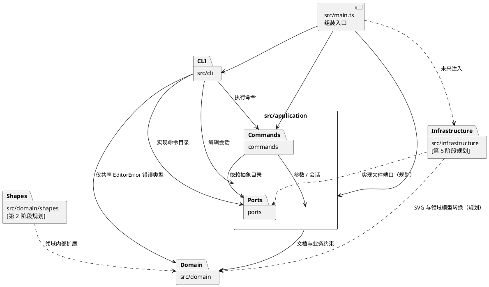

# SVG CLI 编辑器项目文档

本项目对应软件设计课程 PJ1 Phase 1，需求以 [`phase_cli_1.md`](../phase_cli_1.md) 为准。开发分为六次主要增量，完整安排见 [开发计划](DEVELOPMENT_PLAN.md)。

**当前状态：第 1 阶段已实现并通过验证。** 当前增量提供 CLI 骨架、Command 模式和画布管理；图形与文件功能将在后续阶段完成。下一次开发从第 2 阶段接续。

## 1. 架构方案

### 1.1 模块与职责

| 模块 | 职责 | 当前阶段 |
| --- | --- | --- |
| `src/cli/` | 逐行读取终端输入、解析参数、注册命令、格式化交互与错误输出 | 第 1 阶段 |
| `src/application/` | 保存当前编辑会话，校验命令参数，组织用例执行 | 第 1 阶段 |
| `src/application/commands/` | 每个命令一个类，封装命令语法、说明与执行行为 | 第 1 阶段 |
| `src/application/ports/` | 定义应用层所需的抽象能力；当前为命令目录接口，后续增加文件端口 | 第 1 阶段起 |
| `src/domain/` | 封装 SVG 文档和业务约束；当前负责画布尺寸 | 第 1 阶段 |
| `src/domain/shapes/` | 图形类层次、容器结构、几何行为与属性约束 | 第 2 阶段规划，尚未创建 |
| `src/infrastructure/` | SVG 解析与序列化、文件读写，实现应用层端口 | 第 5 阶段规划，尚未创建 |
| `src/main.ts` | 创建并连接对象，将具体实现注入使用者 | 第 1 阶段 |
| `test/` | 领域、解析器、命令行为和 CLI 端到端检查 | 第 1 阶段起 |

架构图以包图表达依赖方向，虚线说明尚未实现的模块：

### 1.2 设计模式与落地

**Command（第 1 阶段）。** `Command` 是命令抽象基类，暴露命令语法、说明和统一的 `execute(args, session)` 入口。`HelpCommand`、`InitCommand`、`CanvasCommand` 分别实现具体用例。`Cli` 负责读行、调用解析器并请求注册表取得命令，不包含每条业务命令的分支实现。

`CommandRegistry` 实现 `CommandCatalog` 接口，帮助命令通过目录接口获得当前可执行命令的说明。这样帮助内容随注册变化，`application` 无须反向导入 `cli`。当前 `help` 仅显示已实现的命令。

**Composite（第 2—4 阶段规划）。** 普通图形和 `g` 将共享图形操作契约，容器保存有序子节点。`move`、`scale`、`set`、`delete` 使用多态；容器负责递归语义。第 1 阶段没有图形类，不宣称已经实现 Composite。

**图形工厂（第 2 阶段规划）。** 类型名在工厂转换为具体图形对象，几何校验与行为封装在图形类中。命令不直接对 `rect`、`circle` 等类型逐个分支。

**历史记录（第 3 阶段规划）。** 每条成功编辑为一个历史单元，初期采用执行前后的文档快照。此方案便于恢复分组层级、节点顺序及删除的子树，代价是每次编辑需要复制文档。课程规模下先保证正确性；未来大型文档可替换为命令差量记录。失败命令不得产生历史项，撤销后成功执行新编辑则清空 redo。

题目允许且要求标注的两处按名字分派如下：

| 位置 | 状态 | 待重构方向 |
| --- | --- | --- |
| `CommandRegistry`：命令名 → 命令对象 | 第 1 阶段的唯一命令分派处，**待重构** | 后续可改为外部命令提供者注册；当前集中注册即可满足范围 |
| 图形工厂：类型名 → 图形类 | 第 2 阶段引入，**待重构** | 后续可引入 `ShapeProvider`；本次只注册六种内置类型 |

“待重构”表示未来扩展边界，不表示当前要增加插件加载、容器或服务定位器等额外机制。本次不会在其他模块新增按命令名或图形类型名的分派。

### 1.3 依赖方向规则

1. `domain` 只依赖领域内部类型和语言标准能力，不导入终端、文件系统、XML 库、CLI 或应用层。
2. `application` 可以依赖 `domain` 和自身 `ports`，不能依赖 `cli` 或 `infrastructure` 的具体实现。会话负责用例所需状态，命令负责组织校验与调用，几何行为仍归领域模型。
3. `cli` 可以依赖 `application` 及其公开命令接口，并仅为输入解析和注册错误使用 `domain/EditorError`；不依赖 `SvgDocument` 或具体图形，不直接修改领域对象内部字段。终端和流式 IO 保持在此模块。
4. `infrastructure` 可以依赖应用端口和领域对象，实现读写及格式转换；业务层不反向导入它。
5. `main.ts` 可以依赖各模块，用于组装对象，避免业务模块自己查找全局依赖。

这些规则让终端交互、SVG 文件格式和图形业务能够分别演进，也便于在测试中直接调用命令和领域模型。违反规则的依赖必须记录在本文件并处理，不能以“暂时能运行”为理由隐藏。

### 1.4 变化点假设

| 可能变化的地方 | 当前预留或取舍 |
| --- | --- |
| 增加命令或改变终端输入方式 | 命令对象与 CLI 分离；注册表收集语法说明；未来 GUI / agent 可复用应用入口 |
| 增加图形类型和复合图形 | 计划使用图形多态、Composite 和集中工厂；本次不提前实现 `box` 插件 |
| 外部 SVG 的解析能力 | 计划通过文件端口和基础设施适配隔离；第 5 阶段再确定支持范围并补充文档 |
| 改变历史存储方式 | 计划将历史集中管理；快照优先保证语义，可在有性能证据后替换为差量 |
| 扩展属性或更严格数值约束 | 领域对象负责几何和属性白名单，命令只负责参数形态；有限正尺寸已在文档模型中封装 |
| 大规模插件系统 | 本次不预先实现动态加载和生命周期；课程后续需要时再围绕两个注册点扩展 |

## 2. 过程记录与 AI 协作

协作采用学生负责需求与阶段决策、AI 辅助实现与调试的方式。下表记录已经发生的讨论和设计取舍；学生人工验收结果在完成后补充。

| 阶段 | 发生的讨论或决策 | 分工与结果 |
| --- | --- | --- |
| 需求与计划 | 学生提供课程要求，要求分阶段开发、提交，并保留协作过程 | AI 提出六阶段路线；学生确认按此执行，授权第 1 阶段实施和本地提交 |
| 架构草案 | 将终端输入、应用命令和领域约束分层；选择 Command，后续引入 Composite | AI 提出方案和实现草案；方案由学生确认，关键类与依赖规则写入本文件 |
| 命令目录边界 | 帮助命令需要读取注册信息，直接导入 CLI 注册表会造成应用层反向依赖 | AI 辅助设计 `CommandCatalog` 端口，让注册表实现接口，帮助命令依赖接口 |
| 错误后的状态 | `init` 或 `canvas` 的第二个尺寸无效时，不能先修改第一个尺寸 | AI 辅助将全部数值校验放在赋值前；会话仅在新文档构造成功后替换当前文档；对应检查纳入测试 |
| 输入解析 | 题目要求注释，也要求使用 `#ffffff` 颜色；文本会包含空格、中文及引号 | AI 辅助把注释限定为整行，采用独立解析器处理双引号与转义，避免按空白直接切分 |
| 依赖自查 | 检查 import 时确认 CLI 解析器与注册表使用了领域的共享错误类型 | AI 辅助补充架构图和依赖规则中的 `EditorError` 许可，保持文档与代码一致 |
| 第 1 阶段验证 | 检查数值约束、失败不变更、参数解析、帮助和真实 CLI 进程 | AI 辅助编写的 23 项测试全部通过，并执行真实终端及 EOF 检查；学生手工验收待执行 |

学生后续的职责包括审阅关键设计、实际运行命令、检查 SVG 渲染结果并反馈问题。只有实际发生后，才补充相应决定或修订记录。

## 3. 一致性自查

本节为第 1 阶段的阶段性检查；课程要求的最终一致性自查将在第 6 阶段完成。

| 检查项 | 当前判断或待核对内容 |
| --- | --- |
| 模块划分 | 第 1 阶段以 `cli`、`application`、`application/commands`、`application/ports`、`domain` 和 `main.ts` 落地；图形和基础设施目录按后续阶段创建，无需创建空目录冒充实现 |
| Command | 已核对三个现有命令均继承 `Command`，由 `CommandRegistry` 单点按名字分发并多态执行 |
| 领域封装 | 已核对 `SvgDocument.resize` 先校验后赋值、`EditorSession.initialize` 先构造后替换；失败场景测试通过 |
| 依赖方向 | 已检查全部源码 import：domain 仅有内部依赖；application 不导入 CLI 或基础设施；CLI 的领域依赖仅为 `EditorError`；帮助命令依赖 `CommandCatalog` 接口 |
| 尚未实现的设计 | Composite、图形工厂、历史记录和 SVG 适配均明确标为规划 |
| 最终自查 | 尚未到最终交付，不宣称全功能或全部依赖规则已通过最终验收 |

修订记录：

| 阶段 | 修订 |
| --- | --- |
| 1 | 增加 `application/ports/CommandCatalog`，明确帮助目录的依赖倒置；将 `init [w] [h]` 的单参数行为定义为使用默认高度 600；将 `canvas` 的修改形式限定为两个尺寸参数；显式列出 CLI 对共享 `EditorError` 的依赖 |

## 4. 功能完整性与质量保证

### 4.1 需求覆盖状态

| 要求 | 本阶段状态 | 后续阶段 |
| --- | --- | --- |
| TypeScript、OOP、一类一文件、Command | 已实现并检查 | 后续持续检查 |
| `svg>`、逐行输入、整行注释、引号参数、统一错误前缀 | 已实现并验证 | 后续加入图形参数用例 |
| `help`、`init`、`canvas` | 已实现并验证 | 历史限制在第 3—5 阶段完善 |
| 六种图形、唯一 ID、`create ... in`、`tree`、`show` | 未实现 | 2 |
| 移动、缩放、属性、删除、撤销重做 | 未实现 | 3 |
| 分组、解组、归属和层次顺序 | 未实现 | 4 |
| SVG 读写、补 ID 警告、XML 转义 | 未实现 | 5 |
| 文档命令后禁止 undo/redo | 未实现 | 3—5 |
| 完整示例回放、浏览器预览、最终标签与远程交付 | 未完成 | 6 |

### 4.2 检查方法

第 1 阶段使用固定版本的 TypeScript 和 Node.js 类型声明，运行时不依赖第三方库。`npm run check` 作为统一检查入口，执行类型检查、编译及测试。

测试从三个层次确认行为：

- 领域与会话：默认尺寸、合法小数、非有限与非正尺寸、初始化及调整失败后的状态保持。
- 参数和命令：空行、整行注释、带空格与中文参数、引号与反斜杠转义、未闭合引号、参数个数和未初始化错误。
- 真实 CLI 子进程：脚本输入、输出摘要、错误后继续执行，以及管道模式没有 `svg>` 提示符。

后续每阶段增加能验证用户行为的用例：嵌套容器递归变换、结构和顺序恢复、失败不产生历史、redo 分支清空、XML 特殊字符往返及题目典型会话。第 6 阶段将生成 SVG 在浏览器中预览，核对结构与实际显示。

第 1 阶段检查记录（2026-10-17）：

| 检查 | 实际结果 |
| --- | --- |
| 环境 | Node.js 24.18.0、npm 11.16.0、TypeScript 5.9.3；开发依赖固定版本并提交 lockfile |
| `npm run check` | 类型检查、编译成功；23 项测试通过，0 失败 |
| 真实终端 | 显示启动说明和 `svg>`；执行 `help`、`init 400`、非法 `canvas 120 -1` 后，查询仍为 400×600；Ctrl+D 正常退出 |
| 导入关系 | 已检查源码 import，与第 1.3 节依赖规则一致 |

以上为 AI 辅助开发期间实际执行的检查。学生人工验收、全功能验证和 SVG 渲染检查仍按后续阶段推进。

### 4.3 最终验收清单

- 对照命令总表逐项检查参数、成功输出和错误约定。
- 回放题目的完整 transcript 和两节点流程图版本 A；版本 B 的 `box` 不在本次范围。
- 检查所有失败命令均不改变文档、节点顺序和历史状态。
- 抽样检查 import 与本文的依赖方向一致，检查仅保留两处允许的名字分派。
- 核对实际目录、实现与设计模式说明，补齐真实协作和修订记录。
- 检查分阶段提交、远程仓库和最终 `final` 标签，记录实际状态。
