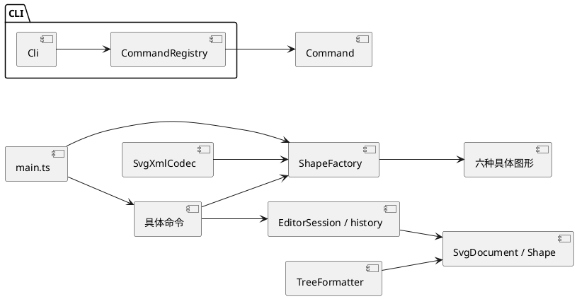
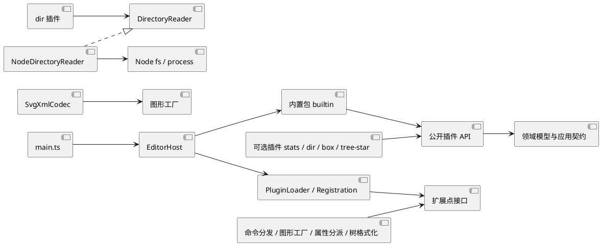
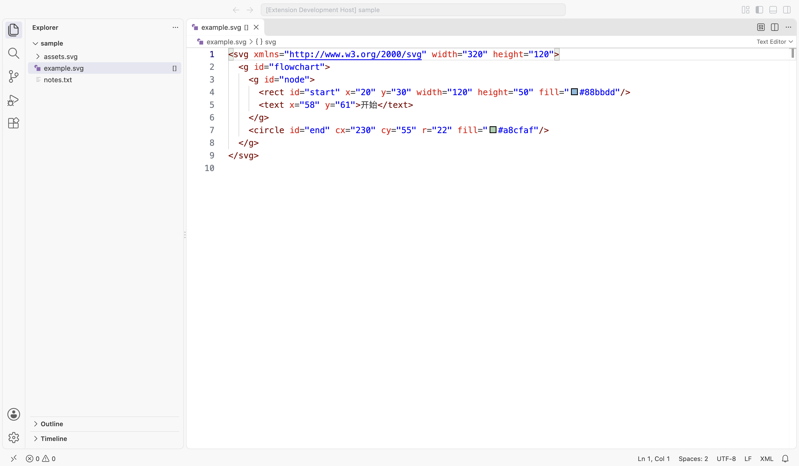
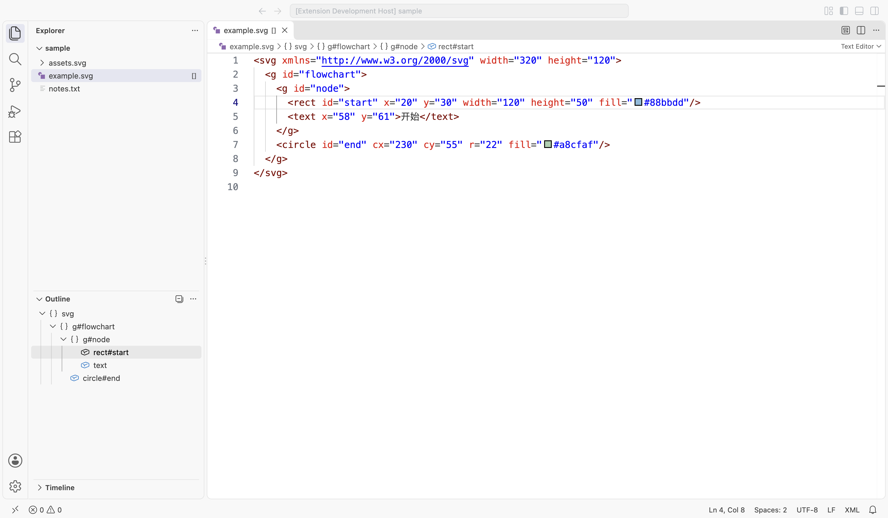

# PJ1 Phase 2 · 插件实践与插件式重构

周乐涵 2026-11-27

对应同一远程仓库中 Phase 1 之后的持续开发。运行源码基线为 `cdbd319`，验收及文档审阅已完成，最终交付通过 `p2` 标签定位。[运行入口](../README.md) · [验收记录](PHASE2_ACCEPTANCE.md) · [Phase 1 报告](https://github.com/leoh4mster/svg-editor-cli-pj1/blob/final/doc/README.md)

## 1. 成果及架构变化

本次完成 VS Code 的文件装饰、原生大纲，以及 CLI 的四个扩展点。stats、dir、box 和 tree-star 为独立插件包，均以类实现行为、以实例激活。CLI 原有十九条命令和六种图形通过内置包注册。关闭可选插件后，Phase 1 的命令和输出保持兼容。

### 重构前

Phase 1 入口直接创建具体命令，图形工厂同时保存具体构造配方和 SVG 字段映射。图形属性通过模型白名单设置，树格式器输出固定结构。



### 重构后

内核定义公开接口并在编辑、图形创建、SVG 读回和树格式化时调用它们。加载器在宿主一侧完成解析与装配，插件通过公开 API 接入。领域模型保留 id、层级、几何和所有权校验。事务、历史和文件系统适配能力继续复用。



| 位置 | 职责 |
| --- | --- |
| `src/domain/` | 图形行为、文档层级、id 与几何约束 |
| `src/application/`、`src/cli/` | 会话事务与历史、扩展调用、命令解析和分发 |
| `src/extensions/` | 四个扩展点及可供插件使用的公开 API |
| `src/infrastructure/` | SVG 编解码与文本文件适配 |
| `src/host/`、`src/main.ts` | 内置能力和可选插件的装配、模块定位、注册校验 |
| `plugins/` | 内置图形与命令、stats、dir、box、tree-star |
| `vscode-extension/` | 独立构建的编辑器扩展及其测试、示例 |

## 2. 扩展点清单与调用契约

全部可选插件只引用 `src/extensions/index.ts` 中的公开领域抽象和契约。内核运行模块不导入插件实现或宿主。配置加载器不包含具体插件包的名称映射。[接口](../src/extensions/Contracts.ts) · [公开 API](../src/extensions/index.ts)

| 接口、职责 | 内核调用文件与方法 | 实现 | 禁用及违约行为 |
| --- | --- | --- | --- |
| `ShapeProvider` 定义创建语法、图形构造、SVG 标签及读回 | `ShapeFactory.create / svgProvider` 选择已注册提供者，`SvgXmlCodec.buildShape` 调用 `read` | `BasicShapeProvider` 的六个实例、`BoxProvider`、测试用 `ProbeProvider` | 禁用 box 后基础图形正常，创建 box 报 `unknown shape type: box (is the plugin loaded?)`，带标记的 g 降级。返回 id 必须保留输入 id，违约时整次创建或读取失败 |
| `Command` 提供 usage、description、execute | `CommandRegistry.execute / describeCommands` | 十九个内置命令、`StatsCommand`、`DirCommand` | 未注册命令不列入 help，执行报 `unknown command: <name>`。同类重名由加载器拒绝 |
| `TreeDecorator` 提供根行及图形行的行尾标签 | `TreeFormatter.format` 每次调用 `labels` | `BoxTypeLabel`、`ModifiedStar` | 零装饰器时输出与 final 一致。标签必须是非空单行文本，否则报 `invalid tree label: <name>`。文档与保存点传入隔离副本 |
| `AttributeHandler` 提供目标属性的领域修改 | `AttributeDispatcher.apply`，由 `SetCommand` 在草稿上调用 | `BoxAttributes`、测试用 `ProbeAttribute` | 无匹配时回到原属性白名单。多匹配报 `ambiguous attribute handler: <id>/<attr>`。失败丢弃整个草稿并保留 undo/redo |

相关代码可从[图形工厂](../src/application/ShapeFactory.ts)、[SVG 读回](../src/infrastructure/svg/SvgXmlCodec.ts)、[命令分发](../src/cli/CommandRegistry.ts)、[树格式器](../src/application/formatters/TreeFormatter.ts)和[属性分派](../src/application/AttributeDispatcher.ts)核对。注册时也检查每种扩展所需字段和方法，缺失时报告 `plugin failed to activate`，保留既有能力。

## 3. 两种装配与加载器

构建后，`node dist/src/main.js` 采用[代码装配](../src/host/codePlugins.ts)。有序项为 `{ manifest, plugin, options? }`，manifest 来自插件的 package.json，plugin 为类实例。

`node dist/src/main.js --config plugins.config.json` 采用[配置装配](../plugins.config.json)。配置中的相对模块以配置目录为基准，包名采用该位置的 Node ESM 解析规则，包括 `exports.import`。相对目录可通过 exports 或 main 定位入口，main 缺省为 index.js。配置按数组顺序处理，enabled 为 false 时完整跳过，options 原样传入 activate，缺省为空对象。

```json
{
  "plugins": [
    { "module": "./dist/plugins/stats" },
    { "module": "./dist/plugins/dir" },
    { "module": "./dist/plugins/box" },
    { "module": "./dist/plugins/tree-star" }
  ]
}
```

每个插件提供带 `activate(context, options)` 的默认导出，以 `context.register(category, name, instance)` 注册。package.json 中的 contributes 分为 shapes、commands、decorators、attributes 四类列表，缺省为空。box 清单例如：

```json
{
  "name": "@svgframe/plugin-shape-box",
  "type": "module",
  "main": "./BoxPlugin.js",
  "contributes": {
    "shapes": ["box"],
    "attributes": ["box-attributes"],
    "decorators": ["box-type-label"]
  }
}
```

两种装配共用 `PluginLoader.activate → Registration.commit`。options 的传递使用测试包 probe 验证，两种装配传入相同 message，执行 probe-info 得到相同输出。测试包使用独立清单和公开 API。[加载器](../src/host/loader/PluginLoader.ts) · [注册事务](../src/host/loader/Registration.ts) · [双装配测试](../test/Framework.test.ts)

| 故障 | stderr 诊断及后续行为 |
| --- | --- |
| 顶层模块不存在 | `error: plugin not found: <module>`，继续下一项 |
| 没有默认导出 | `error: plugin has no default export: <module>`，继续下一项 |
| 声明与注册不符 | `error: plugin manifest mismatch: <name> (declared: …, registered: …)`，撤销该插件全部暂存注册 |
| 求值、依赖导入或 activate 失败 | `error: plugin failed to activate: <name> (<reason>)`，继续后续插件 |
| 同类注册名称重复 | `error: duplicate registration: <category>/<name>`，拒绝该插件整批注册 |
| 配置读不到或语法、结构非法 | `error: invalid plugin config`，以默认内置能力启动 |

## 4. 插件行为与设计决策

### stats 和 dir

stats 从画布直接子节点按当前顺序前序遍历。容器只计入 containers，根 SVG 不计入。叶子按类型首次出现顺序计数，box 的内部矩形和文字计入叶子。空文档输出 `(total 0, containers 0)`。统计是查询，保留原历史。[统计实现](../plugins/stats/StatsCommand.ts)

dir 不接收参数，无需打开画布。它列举进程当前目录的直接子项，包括隐藏项。read/save 不改变进程目录。适配器模式中，客户端是 `DirCommand`，目标接口是 `DirectoryReader`，适配器是 `NodeDirectoryReader`，被适配的能力是 `process.cwd` 与 `fs.readdirSync`。适配器把 Dirent 转成名称和类型，命令负责排序、格式化、参数与错误。[接口](../plugins/dir/DirectoryReader.ts) · [适配器](../plugins/dir/NodeDirectoryReader.ts) · [命令](../plugins/dir/DirCommand.ts)

目录在前，其余条目在后，各组按名称的 UTF-16 码元升序。普通文件、符号链接、其他特殊项分别为 FILE、LINK、OTHER，标记和名称间两个空格。失效链接也列出，链接和子目录均只显示本项。名称内的反斜杠、回车、换行显示为转义文本，保证一项一行。空目录输出 `(empty directory)`，读取失败报 `error: cannot read directory: <path>`，随后仍可使用 CLI。

### ADR 1 · 属性行为与一次编辑的事务

处理器 handles 只判断目标图形与属性，apply 取得公开图形及当前编辑草稿，通过文档方法修改子部件。恰好一个命中才调用，多匹配拒绝整次操作，避免静默覆盖。无匹配时执行 Phase 1 规则。handler 抛错后保留原文档、当前路径和 undo/redo，成功时统一提交一个编辑快照。因此即使一次 set 修改多个部件，也只需一次 undo。测试 probe 在部分写入后抛错，并验证原 redo 仍有效。[事务](../src/application/EditorSession.ts) · [验证](../test/Framework.test.ts)

### ADR 2 · box 的不变量与读回降级

模板派生 `<id>-rect` 和 `<id>-label`，默认矩形填充 #4a90d9，文字位置为 `(x+20, y+h/2+5)`，与题目示例一致。整个新增子树参与全局 id 检查，任一冲突整次创建失败。

两个必要部件必须为指定 id、指定类型的直接子节点。允许修改其几何和顺序，移出、删除或重新分组导致缺件时拒绝。box 允许附加子节点、嵌套 box、整体移动缩放或删除，ungroup 报 `cannot ungroup composite shape: <id>`。模型通过重写已有的子节点替换和复制方法维护约束。[Box](../plugins/box/Box.ts)

SVG 输出为 `g data-kind="box"`。插件存在时恢复完整子树并校验，缺件或类型错时拒绝整个读取，重复 id 也拒绝，保留原文档。插件缺席时作为普通 g，保留标记、样式和子节点，重新安装后可恢复。set box fill 转发到矩形，label 转发到文字；导入时原分组样式仍保存在分组自身。[提供者](../plugins/box/BoxProvider.ts) · [属性处理器](../plugins/box/BoxAttributes.ts)

### ADR 3 · dirty、祖先传播与标签顺序

dirty 按当前内容与成功 init/read/save 的快照比较。比较类型、SVG 标签、属性值、文本、父节点归属与直接子节点顺序；属性的插入顺序忽略。根行另外比较尺寸、根属性和顶层顺序。新建节点立即标星，新空画布和成功读取从无星开始。相同内容的操作不增加星号，撤销回保存点消星，重做恢复。

修改传播到当前祖先及根行。移动归属时原容器也因子列表变化得到标记；删除后标记仍存在且受影响的祖先。尺寸变化只影响根行。未保存 id 集合封装在 ModifiedStar 实例中，每次请求重新比较并返回独立 Map。默认同一行先 `(box)` 后 `*`，按注册顺序拼接。两种标签互不依赖。[星号](../plugins/tree-star/ModifiedStar.ts) · [box 标签](../plugins/box/BoxTypeLabel.ts)

### ADR 4 · 清单校验与失败回滚

整份配置先验证结构，再依序加载插件。每个 activate 使用独立暂存注册表，激活成功后比较四类名称集合，再整体发布。重复、清单不符和抛错都丢弃当前批次；即使插件自行捕获重名异常，这一批也无法发布。激活后的上下文关闭，不能继续追加。模块定位与求值区分，已有包的缺失依赖归入加载失败。[加载与回滚测试](../test/PluginLoader.test.ts)

## 5. VS Code 实践
### 第一阶段 · 从 VS Code 原生大纲到 SVG 源码导航

实现之前，先在独立的 VS Code 窗口打开一个嵌套 JSON 文件。内置大纲把 `start` 和 `end` 显示为 `diagram` 的子节点。点击 `start` 后，编辑器跳到第 3 行第 5 列，面包屑也切换到对应属性。SVG 扩展沿用这套交互，把嵌套关系和源码位置交给宿主。扩展的构建、F5 启动和测试命令见[复现说明](../vscode-extension/README.md)，演示使用[示例 SVG](../vscode-extension/sample/example.svg)。

**文件标记。** 下图取自本机 VS Code 1.144.0 的 Extension Development Host。Explorer 中只有文件 `example.svg` 右侧显示 `[]`，目录 `assets.svg` 和普通文件 `notes.txt` 均没有标记。



**大纲定位。** 下图是在同一窗口点选 `rect#start` 后截取的。左侧显示两层分组和无 id 的 `text`，右侧面包屑指向同一个矩形，状态栏显示第 4 行第 8 列。



### 注册、回调与设计模式

| 调用位置 | 插件负责 | VS Code 负责 |
| --- | --- | --- |
| 激活入口 | 将两个 provider 注册到宿主，将注册句柄、文件监听器和事件加入 `context.subscriptions` | 激活扩展，按需调用 provider，释放已登记的资源 |
| Explorer 请求文件装饰 | `SvgBadgeProvider` 检查 URI 后缀，再通过 `workspace.fs.stat` 区分文件和同后缀目录。对于 SVG 文件返回带 `[]` 的 `FileDecoration`；创建或移除条目时通知宿主刷新 | 渲染已有文件行，将装饰附加到该行；文件名及文件内容始终由文件系统维护 |
| 打开或编辑 SVG 源码 | `SvgOutlineParser` 解析当前内存文本并保留节点的 UTF-16 起止偏移。`SvgOutlineProvider` 把节点转换成宿主的 `DocumentSymbol`。每个节点的 `range` 覆盖整个元素，`selectionRange` 指向开始标签名 | 重新请求符号，显示层级、展开与选中状态，并按位置导航。编辑时 XML 暂不完整，宿主可以显示空大纲 |

经典 **Decorator** 包装实现同一接口的组件，转发原操作并附加行为。这里也通过组合给已有文件行增加显示信息，但 provider 持有的是文件查询能力和变化事件，由 Explorer 主动调用。插件没有包装文件对象；最终合并、绘制装饰的是宿主。源码可对照[激活与注册](../vscode-extension/src/extension.ts)和[文件标记实现](../vscode-extension/src/SvgBadgeProvider.ts)。

**Adapter** 的角色在大纲中更直接。宿主要求的目标接口是 `DocumentSymbolProvider`，被适配对象是输出 XML 名称、源码偏移和子节点的解析器。适配器 `SvgOutlineProvider` 组合这个解析器，再用 `TextDocument.positionAt` 转换坐标，组装宿主接受的符号树。文件标记一侧也会把文件状态转换为宿主要求的装饰结果。两个 provider 共享注册与回调方式，返回值各自解决不同问题。[大纲适配器](../vscode-extension/src/SvgOutlineProvider.ts) · [VS Code API](https://code.visualstudio.com/api/references/vscode-api)

### Phase 1 的复用范围

- **解析**沿用与 CLI 相同版本的 `saxes` 解析库，借助开闭标签事件处理自闭合元素、注释及带引号的属性。CLI 的 `SvgXmlCodec` 服务于可编辑图形导入，会验证支持范围、给无 id 的图形分配 id，转换后也没有保留原始标签的位置。大纲需要展示文件里实际存在的标签，因此使用独立的轻量解析器。[CLI 编解码器](../src/infrastructure/svg/SvgXmlCodec.ts) · [大纲解析器](../vscode-extension/src/SvgOutlineParser.ts)
- **模型与遍历**沿用父子关系和文档顺序的思路。CLI 的 `Shape` 带有移动、缩放和编辑约束，`TreeFormatter` 输出带连线和几何信息的终端字符串。VS Code 只需要层级、名称和位置，因此扩展使用小型节点结构，并保留根元素以及无 id 的元素。[Phase 1 树格式器](../src/application/formatters/TreeFormatter.ts)

### 验证及 AI 协作记录

学生确认六阶段方案、实现扩展、执行测试、操作真实界面，AI负责辅助测试、debug、整理证据。

本阶段一次具体修正来自宿主测试：最初的断言要求符号查询在无结果时严格返回空数组，实际版本的 `vscode.executeDocumentSymbolProvider` 返回了 `undefined`。测试改为验证没有符号，并继续对同一文档输入合法 XML，检查节点恢复。解析器本身返回空数组的契约仍由单元测试直接验证。

| 2026-11-26 的检查 | 实际结果 |
| --- | --- |
| 解析器单元测试 | 4 项通过。覆盖嵌套分组、匿名叶子、顺序、CRLF、多行标签、非 BMP 字符、无效 XML 及后续恢复 |
| 真实扩展宿主集成测试 | 通过。检查三类目录项、文件字节、符号层级、定位范围；在同一未保存文档连续输入有效、残缺、有效的 XML，验证符号随编辑变化 |
| 开发宿主界面 | 文件装饰和点击定位见上图。实测 XML 多写一个 `>` 时大纲提示无符号；移除后出现 `svg → g#live-demo`。最后恢复示例文件 |
| 原 CLI 回归 | 仓库根目录执行 `npm run check`，131 项通过，0 项失败 |


## 6. 开闭原则的 Git 证据

box 的两条接入提交具有同一个父提交 b132c27，插件源码逐字节一致。代码装配只改一处顶层装配，配置装配在已有运行源码零改动的情况下生效。合并提交 26e1b46 保留两条历史。

| 提交 | 运行文件变化 | 必要的测试和文档变化 |
| --- | --- | --- |
| 0cf5728 | 新增 stats 包，修改 codePlugins.ts | 独立测试 |
| 2757756 | 新增 dir 包，修改 plugins.config.json | 替身与真实文件系统测试 |
| f41daf2，box 方式 A | 新增 box 包，修改 codePlugins.ts | box 独立测试、§6.1 B 输入和输出，旧版 CLI 测试显式禁用可选插件 |
| 601da5a，box 方式 B | 新增相同 box 包，修改 plugins.config.json | 与方式 A 相同的测试和会话材料 |
| bbdef3f，星号接入 | 新增 tree-star 包，修改 codePlugins.ts | 独立状态机测试 |

检查各提交前后，内核、加载器与既有插件差异均为空，且这些路径在两端实际存在。loader 中的 import、require、switch 搜索结合人工阅读核对，只有动态入口的 import，没有具体插件映射。所有插件仅通过公开 API 依赖内核。

```sh
git diff --name-status f41daf2^ f41daf2
git diff --name-status 601da5a^ 601da5a
git diff f41daf2 601da5a -- plugins/box
git diff f41daf2^ f41daf2 -- src/application src/domain src/cli src/extensions src/infrastructure src/host/loader plugins/builtin plugins/dir plugins/stats
rg -n "import|require|switch" src/host/loader
```

## 7. 指标与质量保证

[指标脚本](../scripts/metrics.mjs)从 Git 历史取源码，以同一 TypeScript AST 口径统计。当前 [Phase 2 指标](../docs/metrics/phase-2.md)对照 final 和 cdbd319，包含全部文件的职责、行数及复杂度。CLI 的运行源码从 2364 行增至 3101 行，累计圈复杂度从 521 增至 766。内核降为 1982 行、复杂度 483，装配处 350 行、118，插件 769 行、165。新增加载校验和回滚增加了总复杂度，具体业务扩展已转到独立包。VS Code 单列 111 行、复杂度 25。测试、依赖、构建结果和指标脚本排除。

最终交付的运行源码与 cdbd319 一致。使用 final/p2 重新计算可核对相同的文件清单和指标，报告头的 SHA 对应各次被测提交。首次框架指标保存在 stage-2.md。[复现口径](../docs/metrics/README.md)

本机最终复核为 CLI 163 项通过、扩展解析 4 项通过，以及真实 VS Code 宿主集成测试通过。三类规定会话分别覆盖基础兼容、box 流程图及 stats/dir，新标签另有状态会话。每个测试使用独立临时目录；dir 双装配比较共用同一个固定目录，日志在父进程内捕获。[完整验收与命令](PHASE2_ACCEPTANCE.md)

## 8. 六阶段过程

| 阶段 | 实际成果 | 代表提交 |
| --- | --- | --- |
| 1 | 原生大纲观察、扩展、真实截图及复用分析 | 1c3db4f |
| 2 | 四个接口、共同装配校验、回滚、兼容回归及首次指标 | 30499fa、0e5c95b |
| 3 | stats、dir、目录访问适配器、双装配验证 | 0cf5728、2757756、b132c27 |
| 4 | box、属性处理、独立 A/B 差异、读回和降级测试 | f41daf2、601da5a、26e1b46、f54d4e5 |
| 5 | 未保存标签与 box 类型标签共存，保存点测试 | bbdef3f、cdbd319 |
| 6 | 逐项总验收、最终报告、完整指标及审阅材料 | 完成验收、文档审阅与最终交付，版本标记为 p2 |


有代表性的检查和修正包括宿主无符号返回值断言、插件内部依赖失败的归因、插件吞掉重名异常后的回滚、box 必要子部件被普通命令移出的拒绝，以及默认树新增星号后对旧格式测试入口的修正。对应证据保存在测试与提交历史中。

## 9. 当前交付状态

第六阶段验收和文档审阅完成，报告及 Phase 2 验收表已填写。Phase 2 以 p2 标签交付，Phase 1 的 final 指向 77112dc。源码、插件、VS Code 截图、会话、指标脚本及过程提交均已具备。运行边界包括 Phase 1 的 SVG 子集、同步文件系统访问和快照历史，插件加载属于应用启动阶段。
