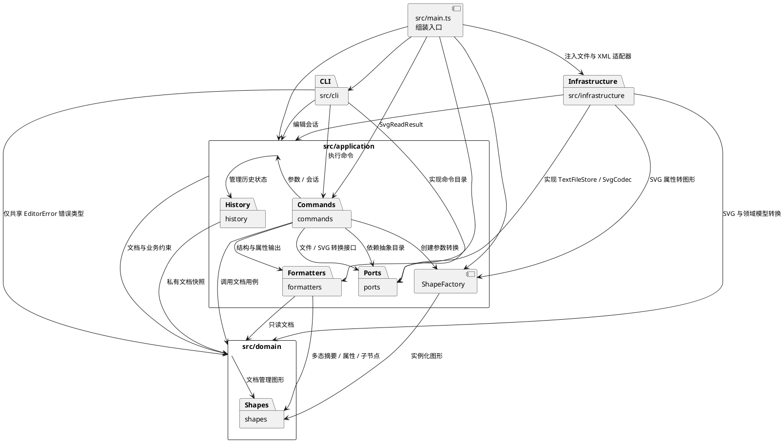

# SVG CLI 编辑器项目文档

本项目对应软件设计课程 PJ1 Phase 1，需求以 [`phase_cli_1.md`](../phase_cli_1.md) 为准。开发分为六次主要增量，完整安排见 [开发计划](DEVELOPMENT_PLAN.md)。

**当前状态：第 5 阶段已实现并通过综合验证。** 本增量通过应用端口隔离文件系统与 XML 转换，保留已有编辑、层级和历史行为；最终验收留到第 6 阶段。

## 1. 架构方案

### 1.1 模块与职责

| 模块 | 职责 | 当前阶段 |
| --- | --- | --- |
| `src/cli/` | 逐行读取终端输入、解析参数、注册命令，处理交互与错误输出 | 第 1 阶段起 |
| `src/application/` | 保存当前编辑会话，校验命令参数，组织用例执行 | 第 1 阶段起 |
| `src/application/commands/` | 每个命令一个类，封装命令语法、说明与执行行为 | 第 1 阶段起 |
| `src/application/history/` | 封装编辑前后文档快照及 undo / redo 两栈，隔离历史引用 | 第 3 阶段 |
| `src/application/ShapeFactory.ts` | 在唯一的图形类型注册表中，将 CLI 参数或 SVG 属性转换为图形对象 | 第 2、5 阶段 |
| `src/application/formatters/` | 将领域对象的多态摘要和属性转换为 `tree` / `show` 文本，不执行终端 IO | 第 2 阶段 |
| `src/application/ports/` | 定义命令目录、文本文件存储 `TextFileStore` 和 SVG 格式转换 `SvgCodec` 接口 | 第 1、5 阶段 |
| `src/domain/` | 封装画布尺寸、有序根节点、全局 ID 与父级索引、受控编辑和结构重组，以及统一数值约束和根 SVG 元数据 | 第 1—5 阶段 |
| `src/domain/shapes/` | `Shape` 基类与六种图形；封装几何约束、属性白名单、深拷贝、递归变换、容器重建及结构化 SVG 属性 | 第 2—5 阶段 |
| `src/infrastructure/` | `NodeFileStore` 负责文件读写；`svg/SvgXmlCodec` 负责 XML 解析与序列化，实现应用层端口 | 第 5 阶段 |
| `src/main.ts` | 创建并连接对象，将具体实现注入使用者 | 第 1 阶段起 |
| `test/` | 领域、解析器、命令行为和 CLI 端到端检查 | 第 1 阶段起 |

架构图以包图表达依赖方向。图形属于领域层，显示格式属于应用层，文件和 XML 的具体实现属于基础设施层：

### 1.2 设计模式与落地

**Command（第 1—5 阶段）。** `Command` 是命令抽象基类，暴露命令语法、说明和统一的 `execute(args, session)` 入口。`Cli` 负责读行、调用解析器并请求注册表取得命令，不包含每条业务命令的分支实现。第 3 阶段新增 `MoveCommand`、`ScaleCommand`、`SetCommand`、`DeleteCommand`、`UndoCommand`、`RedoCommand`。第 4 阶段新增 `GroupCommand`、`UngroupCommand`、`AddToCommand`、`FrontCommand`、`BackCommand`；第 5 阶段新增 `ReadCommand`、`SaveCommand`，共十九条具体命令。

可撤销的编辑命令继承 `EditCommand`：统一调用 `EditorSession.executeEdit`，具体命令只组织参数校验、领域操作与结果摘要。`CreateCommand` 迁入相同执行路径，使创建也能撤销。`help/tree/show` 仍是普通 `Command`，文档命令和撤销重做命令分别调用对应会话入口，不混入普通编辑历史。

第 4 阶段的五条结构命令也是 `EditCommand`，只校验参数并调用 `SvgDocument.groupShapes/ungroupShape/addTo/bringToFront/sendToBack`，不持有另一份层级或自行维护历史。一条结构命令整体对应一个撤销单元，合法但顺序未变的命令也按成功编辑记录。

`CommandRegistry` 实现 `CommandCatalog` 接口，帮助命令通过目录接口获得当前可执行命令的说明。这样帮助内容随注册变化，`application` 无须反向导入 `cli`。当前 `help` 仅显示已实现的命令。

**Composite（第 2 阶段落地层级和遍历，第 3 阶段扩展编辑，第 4 阶段扩展结构重组）。** `Rect`、`Circle`、`Ellipse`、`Line`、`Text`、`Group` 继承统一的 `Shape`。叶子的子节点为空，`Group` 保存有序子节点，二者提供统一的摘要、属性和递归遍历接口。`TreeFormatter` 通过多态递归绘制树，不判断图形类型。第 3 阶段统一提供 `clone/moved/scaled/withAttribute`，均返回独立且未归属的图形副本；`Group` 的移动和缩放递归变换子孙。删除容器则移除整棵子树。第 4 阶段增加多态的 `withChildren`：叶子拒绝作为容器重建，`Group` 返回保留自身样式且具有新子树的独立容器，结构算法无须按图形类型名分派。

缩放以坐标原点为中心，同时乘图形位置和尺寸；倍数必须为有限正数，不能通过负值反向缩放，`stroke-width` 与文本内容不随之改变。`set` 的通用白名单是 `fill/stroke/stroke-width`，类型几何属性由各图形实现，`Text` 另支持 `text`；未知属性按题目约定报错。对 `g` 设置样式保存为该容器自己的属性，遵循标准 SVG 继承，不覆盖子节点显式样式。这与将来 `box` 插件自定义的样式传播不同，本次不提前实现插件行为。

**图形工厂（第 2、5 阶段）。** `ShapeFactory` 通过集中注册的类型名 → 构造配方映射创建六种内置图形，未知类型按题目约定报错。工厂位于应用层，因为各类型的 CLI 参数数量、顺序及可选样式属于输入用例；有限坐标、非负尺寸等几何约束仍由领域图形校验。第 5 阶段在同一配方中记录 SVG 几何字段顺序及是否接受文本内容，`create` 和 `fromSvg` 共用唯一类型查找入口。后者将缺省几何值补为零，将外部数值的外围空白和可选 `px` 归一化，再交给原构造与领域校验。XML 适配器不另设按类型名的分支，命令和格式化器也不逐个判断 `rect`、`circle` 等类型。

**文档封装（第 2—4 阶段）。** `SvgDocument` 管理有序根节点、全局 ID 索引和父级关系。插入、替换与删除通过受控入口维护结构及索引，修改前完成校验；替换保留原节点的父级与同级位置。子节点访问返回数组快照，调用者不能通过修改返回数组改变层级。未归属的容器可组装子树；图形一旦挂接，结构修改须通过文档持有的私有令牌，直接调用 `appendChild` 会被拒绝，且不允许跨文档共享已归属节点。文档克隆通过图形的多态 `clone` 重建独立实例，不复用已归属节点、不增加类型分派，也不依赖 JSON 或 SVG 字符串还原。

第 4 阶段结构操作先校验全部选择、目标、祖先关系和插入顺序，再从原树构造新的独立节点森林，放入局部 `SvgDocument` 完成归属及 ID、父级索引重建，全部成功后才接管其私有状态。这样直接调用领域 API 失败也不会留下半次重组，应用层草稿事务则继续保证历史不受失败影响。已归属节点不通过清除归属再复用；成功后旧图形引用不再代表当前文档节点，应按 ID 重新查询。

**结构顺序约定（第 4 阶段）。** 题目要求分组“保持相对顺序”，但没有完整规定跨父级时新组放置的位置，因此明确采用以下规则：

- `group` 至少选择两个不同的 ID；按操作前文档的前序遍历排列组内节点，与 CLI 参数顺序无关。选择中同时包含祖先与后代时，按题目报 `cannot group a container into its own descendant: <祖先id>`。
- 新组父级取所选节点原父级的最近公共祖先，跨根时取画布；新组插入最早受影响的该父级直属子节点位置。同父级时即原来最早被选节点的位置。其余节点保持相对顺序，搬空的原容器仍保留。
- `ungroup` 仅允许嵌套容器，按原顺序将子节点替换到容器原位置；空容器则直接移除。根级容器按题目报 `cannot ungroup top-level container: <id>`，叶子报 `not a container: <id>`。
- `addto` 把源节点放到目标容器最后；同父级时也移到末尾。不允许移入自身或后代；目标缺失或为叶子时沿用 `no such container` / `not a container`。
- `front` 将节点移到同级末尾，遵循 SVG 后绘制的节点显示在上层；`back` 移到同级开头。二者仅在原父级内排序，适用于根级和嵌套节点。

结构操作不计算新几何值，也不展开继承样式：节点自己的几何属性和显式样式保留，继承结果随新父级改变。解组会去掉容器及其自身样式，不把原继承值复制到子图形。这一取舍保持模型中“显式属性”和“继承结果”的区别，后续 SVG 保存也按显式属性输出。

**历史记录与事务（第 3 阶段）。** 每条成功编辑为一个历史单元，`HistoryEntry` 私有保存执行前后文档快照及原编辑摘要；`CommandHistory` 管理 undo / redo。`EditorSession` 先克隆当前文档为草稿，在草稿上完成编辑，再复制提交结果并准备历史快照，全部成功后才切换当前文档并记录历史。提交副本与回调草稿分离，避免回调保留的引用在提交后绕过历史修改当前文档。这样递归变换即使在后面的子节点处发生数值溢出，也不会留下“前几个节点已经移动”的部分结果。失败命令不改变文档、历史或 redo 分支；成功新编辑才清空 redo。

撤销和重做从历史生成新的文档副本，不暴露或复用快照中的可变实例；因此恢复后的后续编辑不会污染旧历史。成功摘要分别为 `undone: <原编辑摘要>` 和 `redone: <原编辑摘要>`。成功 `init/read/save` 或修改画布尺寸时清空两栈并禁用历史，此时 undo 与 redo 均按题目要求报 `undo not allowed after io command`，直到下一次成功编辑；查询画布与其他显示命令保留历史。失败的文档命令保留两栈、禁用状态及保存路径。

每项历史保存两份完整文档，单项空间随节点数线性增长；执行和恢复需要深拷贝，索引重建也有成本，本项目不作大文档性能保证。取舍是先准确恢复层级、节点顺序和被删除的子树；以后可在行为接口不变的前提下替换为命令差量记录。

**文件与 SVG 适配（第 5 阶段）。** 应用层的 `TextFileStore` 端口只负责文本文件能力，`SvgCodec` 端口只负责文档与 SVG 文本转换。`SvgReadResult` 封装解码后的文档与补 ID 警告。`ReadCommand`、`SaveCommand` 依赖这些接口，由 `main.ts` 注入基础设施实现，命令不直接导入文件系统和 XML 库。读取先完成文件解码、XML 解析、ID 检查和完整领域文档构造，再提交到会话；失败不替换文档、不切换路径，也不输出来自未提交结果的补 ID 警告。保存先生成并校验完整 XML，文件写入成功后才更新路径和历史状态。

`EditorSession` 保存最近一次成功 `read/save` 的路径。`save` 无参数使用该路径；尚未确定路径时报错。成功 `init` 清空它，画布尺寸修改、编辑与撤销重做不更改它，失败 IO 保留旧路径。相对路径按进程工作目录解释，含空格路径通过原参数解析器的双引号支持。

`NodeFileStore` 严格解码 UTF-8；写入在目标同目录创建临时文件，完整写入后通过重命名替换，避免半份 SVG 覆盖原文件。覆盖普通文件时保留文件权限；符号链接通过其目标写入，链接本身保留。读取不存在文件或写入失败分别使用题目约定的 `cannot read file` / `cannot write file` 错误，失败临时文件由适配器清理。

`SvgXmlCodec` 使用 `saxes` 解析 XML 1.0，使用 `xmlchars` 校验 XML 名称。基础设施内部的 `SvgElement` 封装解析树的属性、子节点和文本，作为 XML 到领域模型的过渡；它不是应用和领域层的图形数据模型。编码读取 `Shape.svgAttributes`、`textContent`、`children` 和 `isContainer`，通过多态递归输出，不增加图形类型分派。

`Shape` 输出的是规范几何值、显式 `fill/stroke/stroke-width` 和额外属性的只读映射快照。额外属性通过不可变的 `withExtraAttributes` 导入，拒绝覆盖 ID、通用样式或该类型的几何字段；克隆、几何编辑、结构重组和历史恢复均保留它们。`SvgDocument` 同样保留根元数据，输出尺寸及 `viewBox`；导入的 `viewBox` 经校验和归一化后保留，画布修改才重设为 `0 0 宽 高`。根 ID 参与全局唯一性检查，不能被后续创建或分组占用，但根不是可通过 `findShape` 定位的图形。

读取支持范围和保留边界如下：

| 内容 | 行为 |
| --- | --- |
| 根与图形 | 根为 `svg`；图形为 `rect/circle/ellipse/line/text/g`，仅 `g` 接受图形子节点；支持 SVG 命名空间或未声明命名空间的输入 |
| ID | 先遍历全文件保留全部非空显式 ID 并拒绝重复，再按文档顺序为缺失或空 ID 图形分配 `标签名+序号` 并警告；包括根 ID 在内均不能冲突 |
| 尺寸 | 根宽高为有限正数；缺省时依次取 `viewBox` 对应尺寸和 800×600；图形几何值缺省为零，长度接受数字和 `px`，不支持百分比及其他单位 |
| 样式与额外属性 | 保留显式样式、`font-size`、`text-anchor`、`data-*`、根元数据及合法命名空间前缀属性；不据此扩大 `set` 白名单，也不把继承结果写成显式值 |
| 文本 | `text` 接受纯文本、实体和 CDATA，保留解析后的字符；有子元素的复杂文本、坐标列表不支持 |
| 拒绝的内容 | 未知标签、外部元素命名空间、`transform/style/href`、`on*` 事件属性、DOCTYPE 和处理指令；不会静默忽略这些语义 |
| 保存 | 输出 UTF-8 XML 声明和标准 SVG 命名空间，按模型中的有序结构序列化；转义文本、引号、XML 特殊字符和需要保留的换行等字符，并验证生成 XML |
| 非逐字往返 | 注释、原始缩进、原属性顺序、前缀化元素写法、CDATA 或实体原写法不保留；保证所支持模型和显式属性往返，不宣称完整 SVG 保真 |

题目允许且要求标注的两处按名字分派如下：

| 位置 | 状态 | 待重构方向 |
| --- | --- | --- |
| `CommandRegistry`：命令名 → 命令对象 | 第 1 阶段的唯一命令分派处，**待重构** | 后续可改为外部命令提供者注册；当前集中注册即可满足范围 |
| `ShapeFactory`：类型名 → 图形构造配方 | 第 2、5 阶段共用的唯一图形类型分派处，**待重构** | 后续可引入 `ShapeProvider`；本次只注册六种内置类型 |

“待重构”表示未来扩展边界，不表示当前要增加插件加载、容器或服务定位器等额外机制。本次不会在其他模块新增按命令名或图形类型名的分派。

### 1.3 依赖方向规则

1. `domain` 只依赖领域内部类型和语言标准能力，不导入终端、文件系统、XML 库、CLI 或应用层。
2. `application` 可以依赖 `domain` 和自身 `ports`，不能依赖 `cli` 或 `infrastructure` 的具体实现。会话负责用例所需状态，命令负责组织校验与调用，工厂转换创建参数，格式化器生成纯文本，几何行为仍归领域模型。
3. `cli` 可以依赖 `application` 及其公开命令接口，并仅为输入解析和注册错误使用 `domain/EditorError`；不依赖 `SvgDocument` 或具体图形，不直接修改领域对象内部字段。终端和流式 IO 保持在此模块。
4. `infrastructure` 可以依赖应用端口、`ShapeFactory`、`SvgReadResult` 和领域对象，实现文件读写及格式转换；其中 `NodeFileStore` 可依赖 Node.js 文件、路径和加密库，`SvgXmlCodec` 可依赖 `saxes/xmlchars`。XML 库不进入应用层和领域层，业务层不反向导入基础设施。
5. `main.ts` 可以依赖各模块，用于组装对象，避免业务模块自己查找全局依赖。

这些规则让终端交互、SVG 文件格式和图形业务能够分别演进，也便于在测试中直接调用命令和领域模型。违反规则的依赖必须记录在本文件并处理，不能以“暂时能运行”为理由隐藏。

### 1.4 变化点假设

| 可能变化的地方 | 当前预留或取舍 |
| --- | --- |
| 增加命令或改变终端输入方式 | 命令对象与 CLI 分离；注册表收集语法说明；未来 GUI / agent 可复用应用入口 |
| 增加图形类型和复合图形 | 图形多态、Composite 和集中工厂已经落地；格式化器复用图形的统一接口；本次不提前实现 `box` 插件 |
| 外部 SVG 的解析能力 | 已用 `SvgCodec` 与基础设施 XML 适配器隔离；六类型子集外的语义显式拒绝，可在后续阶段扩展，无须把 XML 库引入领域 |
| 改变历史存储方式 | 历史已集中在 `application/history`；私有快照优先保证语义，可在有性能证据后替换为差量 |
| 扩展属性或更严格数值约束 | 领域对象负责几何和白名单约束，应用参数委托领域 `NumericValue` 解析数值；画布为有限正尺寸，图形尺寸、半径、描边宽度允许零；新几何规则在对应图形类内扩展 |
| 大规模插件系统 | 本次不预先实现动态加载和生命周期；课程后续需要时再围绕两个注册点扩展 |

## 2. 过程记录与 AI 协作

协作采用学生负责需求与阶段决策、AI 辅助实现与调试的方式。下表记录已经发生的讨论和设计取舍；学生人工验收结果在完成后补充。

| 阶段 | 发生的讨论或决策 | 分工与结果 |
| --- | --- | --- |
| 需求与计划 | 学生提供课程要求，要求分阶段开发、提交，并保留协作过程 | AI 提出六阶段路线；学生确认按此执行，授权第 1 阶段实施和本地提交 |
| 架构草案 | 将终端输入、应用命令和领域约束分层；选择 Command，后续引入 Composite | AI 提出方案和实现草案；方案由学生确认，关键类与依赖规则写入本文件 |
| 命令目录边界 | 帮助命令需要读取注册信息，直接导入 CLI 注册表会造成应用层反向依赖 | AI 辅助设计 `CommandCatalog` 端口，让注册表实现接口，帮助命令依赖接口 |
| 错误后的状态 | `init` 或 `canvas` 的第二个尺寸无效时，不能先修改第一个尺寸 | AI 辅助将全部数值校验放在赋值前；会话仅在新文档构造成功后替换当前文档；对应检查纳入测试 |
| 输入解析 | 题目要求注释，也要求使用 `#ffffff` 颜色；文本会包含空格、中文及引号 | AI 辅助把注释限定为整行，采用独立解析器处理双引号与转义，避免按空白直接切分 |
| 依赖自查 | 检查 import 时确认 CLI 解析器与注册表使用了领域的共享错误类型 | AI 辅助补充架构图和依赖规则中的 `EditorError` 许可，保持文档与代码一致 |
| 第 1 阶段验证 | 检查数值约束、失败不变更、参数解析、帮助和真实 CLI 进程 | AI 辅助编写的 23 项测试全部通过，并执行真实终端及 EOF 检查；学生手工验收待执行 |
| 远程交付 | 学生要求新建用于本作业的私有 GitHub 仓库 | AI 辅助创建并关联 `leoh4mster/svg-editor-cli-pj1`；第 1 阶段提交 `a005124` 已推送至 `origin/main` |
| 第 2 阶段启动 | 学生要求按照已确认的路线继续第二阶段 | 本增量限于六种图形、创建、层级和查看；不提前混入编辑与文件功能 |
| 工厂位置 | 创建参数既包含 CLI 语法，也对应图形几何规则 | AI 辅助将参数数量和位置转换留在应用工厂，将数值约束放在图形类；领域层不导入命令参数类 |
| 层级与显示 | 嵌套 `g` 和叶子都需要出现在树中，不能让格式化器不断判断类型 | AI 辅助实现统一的子节点、摘要、属性与遍历接口；`tree` 通过多态读取结构，文档统一维护挂接及索引 |
| 创建失败不变更 | 重复 ID、候选子树冲突和无效 `in` 目标都可能导致创建中途失败 | AI 辅助把完整校验置于挂接前，并安排对文档结构、索引和顺序保持的检查 |
| 默认样式与零尺寸 | SVG 的省略样式有默认语义；图形零尺寸与画布尺寸约束不同 | AI 辅助保留未指定的样式，不补写默认颜色；图形尺寸和半径允许零，画布仍要求正尺寸 |
| 归属保护修复 | 代码复查发现，直接调用已入文档的容器 `appendChild` 可以绕过索引 | AI 辅助复现：树中已有子节点，但 `findShape` 报不存在；增加文档私有令牌和节点归属保护，并补充直接挂接、跨文档共享、循环结构的回归测试 |
| 第 2 阶段验证 | 六类型、层级、唯一 ID、输出与失败不变更 | 全套 49 项测试通过；八元素流程图脚本、真实终端及依赖检查通过；学生人工验收尚未记录 |
| 第 2 阶段交付 | 按阶段保留开发增量 | 提交 `6a007af` 已推送至 `origin/main` |
| 第 3 阶段启动 | 学生要求继续既定计划的第三阶段 | 本增量限于基础编辑、递归变换与历史；AI 辅助实现和调试，不提前混入重组与文件功能 |
| 缩放语义 | 题目要求倍数作用于位置和尺寸，并明确拒绝非正倍数 | AI 辅助将正倍数、有限值和变换后溢出检查放在领域层；描边宽度不是本次几何缩放项，文本内容保持不变 |
| 复制与归属 | 直接复用历史中的图形会与当前文档共享节点，违反既有归属约束 | AI 辅助采用图形多态深拷贝；快照与恢复都创建独立实例，历史不向调用者暴露内部文档 |
| 递归失败的原子性 | 依次原地移动容器子节点时，后续节点发生溢出可能留下部分修改 | AI 辅助采用会话草稿执行：在完整编辑、快照准备都成功后提交；失败保留原文档及两个历史栈 |
| 历史边界 | 创建也是编辑，显示命令不入栈；文档命令后 undo/redo 需要同时禁用 | AI 辅助引入 `EditCommand` 统一成功编辑路径，并让文档命令通过同一会话维护禁用状态；读写在第 5 阶段接续 |
| 容器样式 | `g` 与叶子都可设置通用样式，但普通容器没有 `box` 插件的特殊传播规则 | AI 辅助将样式保存在容器自身，遵循 SVG 继承，避免覆写已有子节点样式 |
| 草稿引用隔离 | 测试设计复查提出，回调可能保留成功事务的草稿引用 | AI 辅助在提交边界再克隆一份结果，防止保留的草稿修改当前文档；对应回归测试同时验证当前状态与 undo/redo 快照保持独立 |
| 第 3 阶段验证 | 确认递归编辑、属性白名单、删除恢复、快照隔离与历史分支 | AI 辅助执行的全套 73 项测试通过；第三阶段脚本、前两阶段回放、真实终端及依赖检查通过；学生人工验收尚未记录 |
| 第 3 阶段交付 | 按既定路线形成独立编辑与历史增量 | 提交 `1ba0382` 已推送至 `origin/main` |
| 第 4 阶段启动 | 学生要求继续第四阶段 | AI 辅助实现五条结构命令并更新文档；继续复用既定的 Command、Composite 和会话事务，不增加另一套历史 |
| 跨父级分组 | 题目规定保持相对顺序，但未完整指定跨父级收编的位置 | AI 辅助将规则明确为操作前文档前序顺序、原父级最近公共祖先和最早受影响位置；在文档中公开这一实现约定，待学生审阅 |
| 绘制顺序 | SVG 后绘制的兄弟节点位于上层，CLI 的“前”需要对应实际绘制语义 | AI 辅助将 `front` 对应同级末尾、`back` 对应同级开头；覆盖根级与嵌套节点，保留父级 |
| 结构与归属 | 已归属节点受文档私有令牌保护，不能通过直接摘挂绕过索引维护 | AI 辅助选择多态容器重建和局部完整文档验证后原子接管，保留归属保护；直接领域 API 失败不变更和命令失败不破坏历史的测试均通过 |
| 显式样式 | 移入新容器或移除旧容器可能改变继承外观 | AI 辅助明确只保留节点自己的属性，不把继承值固化到子节点；解组移除容器样式，后续读写据此保留显式属性 |
| 第 4 阶段验证 | 分组、解组、循环拒绝、顺序恢复和失败原子性 | AI 辅助执行的全套 97 项测试通过；第四阶段及前三阶段脚本回放、真实终端和依赖检查通过；学生人工验收尚未记录 |
| 第 4 阶段交付 | 按既定路线形成独立结构编辑增量 | 提交 `8f0439a` 已推送至 `origin/main` |
| 第 5 阶段启动 | 学生要求继续第五阶段 | AI 辅助实现 SVG 读取、保存及验证方案，保留六阶段安排；学生人工代码审阅与渲染验收尚未记录 |
| XML 与 IO 边界 | 文件错误、XML 错误和图形约束应分别隔离，读取失败不能清空当前工作 | AI 辅助设计 `TextFileStore`、`SvgCodec` 端口，文件与 XML 实现放在基础设施；完整读取成功后才提交会话 |
| 唯一类型分派 | 若 XML 适配器按标签逐个构造，会新增题目禁止的类型名分派 | AI 辅助扩展原图形工厂的同一配方注册表，让 CLI 和 SVG 输入共用查找；输出通过图形多态属性递归处理 |
| 缺 ID 避碰 | 按遇到顺序即时命名，可能与文件后面的显式 `rect1` 冲突 | AI 辅助先收集整份 XML 的显式 ID，再按文档顺序分配；根 ID 同样保留并参与唯一性约束 |
| 属性往返范围 | 仅恢复几何值会丢失字体、对齐、根坐标系等信息；完整 SVG 解释器又超出本阶段范围 | AI 辅助保留显式样式和额外属性，公开子集边界，拒绝 `transform/style/href` 等未实现语义；额外属性不绕过 `set` 白名单 |
| 命名空间缺陷与修复 | 代码复查发现：前缀属性原先依赖祖先上的 `xmlns:前缀`，图形移出该容器或解组后会失去绑定，导致保存失败或语义丢失 | AI 辅助在导入时把属性需要的前缀绑定保存在使用它的节点上；补充跨容器移动及解组后的保存、读回回归检查，已通过 |
| 保存与历史 | 无参数保存需要路径状态，成功保存与失败保存对历史的影响不同 | AI 辅助将最近成功路径保存在会话；写入成功后才记路径并禁用历史，失败保留文档、旧路径与 redo 分支 |
| 文件写入修订 | 直接覆盖可能在写入中途失败时破坏原文件，覆盖符号链接也不应替换链接本身 | AI 辅助采用同目录临时文件加重命名，保留普通文件权限与符号链接引用，并安排文件错误回归验证 |
| 第三方声明兼容 | `saxes 6.0.0` 的声明与 TypeScript 5.9 的严格可选属性规则存在兼容问题 | AI 辅助将 `skipLibCheck` 设为 `true`，仅跳过第三方声明内部检查；保留项目源码和测试的严格检查，并在质量保证节说明 |
| 第 5 阶段验证 | XML 往返、文件错误、路径与历史、原阶段回归 | AI 辅助执行的全套 128 项测试通过，0 失败、0 跳过；前五阶段示例回放、真实终端、EOF 和 AST 架构检查通过；学生人工验收尚未记录 |
| 第 5 阶段交付 | 按既定路线形成独立 SVG 读写增量 | 本阶段独立提交；实际提交及推送信息在下一阶段接续时核对并记录 |

学生后续的职责包括审阅关键设计、实际运行命令、检查 SVG 渲染结果并反馈问题。只有实际发生后，才补充相应决定或修订记录。

## 3. 一致性自查

本节为第 5 阶段实现与综合检查后的阶段性自查；课程要求的最终一致性自查将在第 6 阶段完成。

| 检查项 | 当前判断或待核对内容 |
| --- | --- |
| 模块划分 | 按规划创建基础设施，新增文本存储和 SVG 转换端口；XML 过渡树仅存在于基础设施，领域继续持有图形行为 |
| Command | 增加 `ReadCommand`、`SaveCommand`，共十九条具体命令；十条编辑命令继续统一通过 `EditCommand`，IO 命令按文档规则禁用历史 |
| Composite | 结构化 SVG 属性与文本接口由图形多态提供；编码和容器重建不另按类型名分派 |
| 领域封装 | 新增额外属性与根元数据的防御性复制，规范字段不能被额外属性覆盖；克隆和结构重写保留元数据，根 ID 预留防止后续冲突 |
| 依赖方向 | AST 检查已覆盖 49 个源码文件，符合第 1.3 节；基础设施依赖应用端口、工厂、结果对象及领域，组装入口注入实现；Node.js 文件和 XML 库仅在对应基础设施使用 |
| 名字分派 | `create/fromSvg` 复用图形工厂同一类型配方查找，命令仍在原注册表分派；已核对仅有两个集中名字分派点，45 个类均满足一类一文件和文件名匹配 |
| 尚未完成的验收 | 题目完整 transcript、浏览器渲染和最终 `final` 标签留在第 6 阶段；本阶段不宣称完整 SVG 标准兼容 |
| 最终自查 | 尚未到最终交付，不宣称全功能或全部依赖规则已通过最终验收 |

修订记录：

| 阶段 | 修订 |
| --- | --- |
| 1 | 增加 `application/ports/CommandCatalog`，明确帮助目录的依赖倒置；将 `init [w] [h]` 的单参数行为定义为使用默认高度 600；将 `canvas` 的修改形式限定为两个尺寸参数；显式列出 CLI 对共享 `EditorError` 的依赖 |
| 2 | 将图形工厂归入应用层，几何约束保留在领域层；新增应用格式化器；Composite 按第 2、3、4 阶段分别落地遍历、编辑传播、结构调整；复查后补充文档归属令牌，阻止绕过索引的直接挂接 |
| 3 | 新增 `EditCommand`、历史模块和草稿提交路径；图形编辑返回独立副本，文档统一替换与删除；以领域 `NumericValue` 复用数值校验；明确容器标准样式继承与插件自定义传播的边界 |
| 4 | 明确跨父级分组采用最近公共祖先、操作前前序顺序和最早受影响位置；新增多态容器重建及结构操作局部文档原子接管；明确绘制顺序和解组时显式样式的保留规则，沿用原编辑历史 |
| 5 | 增加 `TextFileStore`、`SvgCodec` 和读取结果对象；图形工厂共用 CLI/SVG 构造配方，领域增加规范 SVG 属性、额外属性和根元数据；会话保存最近成功路径；文件使用原子替换，XML 明确六类型子集与拒绝范围；因第三方声明兼容开启 `skipLibCheck`，项目源码和测试仍严格检查 |

## 4. 功能完整性与质量保证

### 4.1 需求覆盖状态

| 要求 | 本阶段状态 | 后续阶段 |
| --- | --- | --- |
| TypeScript、OOP、一类一文件、Command | 已实现并检查 | 后续持续检查 |
| `svg>`、逐行输入、整行注释、引号参数、统一错误前缀 | 已实现并验证，已加入图形参数用例 | 后续持续回归 |
| `help`、`init`、`canvas` | 已实现并验证历史联动 | 持续回归 |
| 六种图形、唯一 ID、`create ... in`、`tree`、`show` | 第 2 阶段已实现并验证 | 后续持续回归 |
| 移动、缩放、属性、删除、撤销重做 | 第 3 阶段已实现并验证 | 后续持续回归 |
| 分组、解组、归属和层次顺序 | 第 4 阶段已实现并验证 | 后续持续回归 |
| SVG 读写、补 ID 警告、XML 转义 | 第 5 阶段已实现并通过综合验证 | 第 6 阶段最终验收 |
| 文档命令后禁止 undo/redo | `read/save` 与 `init`、画布修改的成功后禁用规则均已验证；失败保留历史 | 后续持续回归 |
| 完整示例回放、浏览器预览、最终标签与远程交付 | 未完成 | 6 |

### 4.2 检查方法

使用固定版本的 TypeScript 和 Node.js 类型声明，提交 lockfile 固定依赖。第 5 阶段新增运行时依赖 `saxes 6.0.0` 与 `xmlchars 2.2.0`，分别用于 XML 解析及 XML 名称校验；解析库的能力和 API 参考其[官方文档](https://github.com/lddubeau/saxes)。`npm run check` 作为统一检查入口，执行类型检查、编译及测试。

`tsconfig.json` 保留 `strict`、`exactOptionalPropertyTypes`、`noUncheckedIndexedAccess` 等严格选项。由于 `saxes 6.0.0` 的第三方声明内部不能通过当前 TypeScript 5.9 严格可选属性检查，设置 `skipLibCheck: true`，跳过第三方 `.d.ts` 内部检查；项目源码及测试仍纳入严格类型检查。这一兼容设置不等于关闭项目类型检查，XML 适配行为还须通过实际往返和错误输入测试验证。

测试从三个层次确认行为：

- 领域与会话：默认尺寸、合法小数、非有限与非正尺寸、初始化及调整失败后的状态保持。
- 参数和命令：空行、整行注释、带空格与中文参数、引号与反斜杠转义、未闭合引号、参数个数和未初始化错误。
- 真实 CLI 子进程：脚本输入、输出摘要、错误后继续执行，以及管道模式没有 `svg>` 提示符。

第 2 阶段围绕新增行为补充检查：

- 六种图形的参数、负坐标、零尺寸、非有限及负尺寸拒绝、缺省样式不补写。
- 全局 ID 冲突、大小写和中文 ID、无效容器，以及失败后结构、父级、索引与顺序不变。
- 嵌套容器和候选子树遍历，子节点返回数组不允许间接修改内部结构；直接挂接、节点跨文档共享及自身或祖先循环被拒绝。
- `tree` 的根节点、子树、缩进、顺序及几何摘要；`show` 的完整属性与父级；格式化器不按类型分派。
- 中文与带空格文本、引号转义、`#` 颜色、`in` 尾缀边界，以及真实 CLI 脚本回放。

第 3 阶段围绕编辑事务和历史补充以下验证，实际通过情况见本阶段检查记录：

- 六种图形及嵌套容器移动、缩放；位置与尺寸同时变化，描边宽度及文本内容保持；非正倍数与递归后续节点溢出时不改变当前文档。
- 所有通用样式与各类型几何属性白名单，文本含空格、中文和转义；未知属性、负尺寸、负描边宽度、非有限数值被拒绝。
- 替换后保留父级、同级顺序与 ID；删除容器后子孙索引一起消失，undo 恢复完整子树及原位置；文档归属保护继续生效。
- 创建、编辑、删除按命令记录历史；undo / redo 多步恢复；失败命令与显示命令不改变分支；撤销后成功新编辑清空 redo；恢复对象与历史快照不共享引用。
- 成功初始化与画布修改后两条历史命令均被禁用，下一次成功编辑解禁；失败文档命令、失败编辑及画布查询不改变历史或禁用状态。
- `examples/phase3.cli` 通过真实 CLI 回放编辑和历史流程，同时回归前两阶段示例。

第 4 阶段围绕结构编辑完成以下检查，实际结果见本阶段记录：

- 同父级和跨父级分组采用原文档前序顺序，检查最近公共祖先、插入位置、未选择节点与空旧容器的保留；拒绝重复选择、少于两个节点、重复新 ID 和祖先 / 后代同时选择。
- 嵌套容器解组后子节点占据原位置，空容器移除，根级容器和叶子解组被拒绝；检查容器与子节点各自的显式样式。
- `addto` 在根级与嵌套间搬移整个子树，移到末尾，并拒绝自身及祖先移入后代；无效目标按规定输出错误。
- `front/back` 仅调整原父级内顺序，覆盖根级、嵌套和已经位于目标位置的情况；确认 SVG 后绘制语义。
- 每次结构编辑整体撤销和重做，恢复准确的父级、节点顺序、子树与 ID 索引；失败不修改文档、禁用状态或 redo 分支，成功新编辑清空 redo。
- 直接调用领域方法时校验失败仍原子；新树与旧节点不共享实例，外部无法修改已归属结构；容器重建保持自身属性且不新增类型分派。
- 回放 `examples/phase4.cli` 和前面阶段示例，检查帮助目录和真实 CLI 输出；复查全部 import、一类一文件与两个允许的名字分派点。

第 5 阶段围绕以下行为补充检查，实际执行结果见本阶段检查表：

- 六类型及嵌套结构保存、读回后比较画布、节点顺序、ID、父级、几何、文本、样式与额外属性；导入根 `viewBox` 和根 ID 经过克隆、结构编辑和历史恢复仍保留。
- 缺失及空图形 ID 的警告、全文件预扫描避碰、重复显式 ID、根 ID 冲突和未知类型；XML 中途失败不泄漏半份文档或未提交警告。
- 中文、引号、`&<>`、制表与换行、CDATA 和实体解析的往返；XML 1.0 禁用字符、无效 UTF-8、畸形 XML、错误命名空间和不支持内容被拒绝。
- `read/save` 参数、带空格路径、未初始化保存和无默认路径保存；最近成功路径在新建、画布修改、编辑、undo/redo、成功及失败 IO 后符合约定。
- 成功 IO 清空并禁用两条历史，下一次成功编辑解禁；文件、解析、编码或写入失败保留当前文档、路径、redo 分支和历史禁用状态。
- 文件临时写入与重命名、普通文件权限、符号链接目标、不可读或不可写路径；覆盖失败后原文件内容保留，临时文件得到清理。
- 真实 CLI 回放读写场景，回归前四阶段示例，并核对新增模块的 import、类文件和两个名字分派点。

第 6 阶段回放题目完整会话并将生成的 SVG 在浏览器中预览，核对结构与实际显示。

第 1 阶段检查记录（2026-10-17）：

| 检查 | 实际结果 |
| --- | --- |
| 环境 | Node.js 24.18.0、npm 11.16.0、TypeScript 5.9.3；开发依赖固定版本并提交 lockfile |
| `npm run check` | 类型检查、编译成功；23 项测试通过，0 失败 |
| 真实终端 | 显示启动说明和 `svg>`；执行 `help`、`init 400`、非法 `canvas 120 -1` 后，查询仍为 400×600；Ctrl+D 正常退出 |
| 导入关系 | 已检查源码 import，与第 1.3 节依赖规则一致 |

以上为 AI 辅助开发期间实际执行的检查。学生人工验收、全功能验证和 SVG 渲染检查仍按后续阶段推进。

第 2 阶段检查记录（2026-10-17）：

| 检查 | 实际结果 |
| --- | --- |
| `npm run check` | 类型检查、编译成功；全套 49 项测试通过，0 失败；本阶段新增 26 项 |
| 流程图脚本 | `npm run cli --silent < examples/phase2.cli` 成功构建八元素两节点流程图，输出结构、子树及属性明细，stderr 为空 |
| 真实终端 | 创建嵌套中文文本，执行 `tree` / `show`；重复 ID 报错后原树保持不变；提示符和 Ctrl+D 退出正常 |
| 导入与分派 | 全部 import 符合依赖规则；仅保留两个集中名字分派点；26 个源码文件中的 24 个类全部满足一类一文件且文件名匹配 |
| 人工验收 | 学生手工运行尚未记录；本阶段无 SVG 保存或浏览器渲染验收 |

第 3 阶段检查记录（2026-10-17）：

| 检查 | 实际结果 |
| --- | --- |
| `npm run check` | 类型检查、编译成功；全套 73 项测试通过，0 失败；保留原有 49 项，新增 24 项 |
| 示例回放 | `npm run cli --silent < examples/phase3.cli` 成功，无错误输出；前两阶段示例回放符合预期（第一阶段保留其原有的 1 条预期错误） |
| 真实终端 | 验证容器移动及撤销重做；非法倍数后 redo 仍可用；删除子树后恢复；画布修改禁用历史，后续编辑重新解禁；Ctrl+D 正常退出 |
| 导入与分派 | 全部 import 符合依赖规则，仅有两个集中命令名 / 图形类型名分派点；36 个源码文件中的 34 个类全部满足一类一文件和文件名匹配 |
| 人工验收 | 学生人工验收尚未记录；本阶段不包含 SVG 浏览器渲染检查 |

第 4 阶段检查记录（2026-10-17）：

| 检查 | 实际结果 |
| --- | --- |
| `npm run check` | 类型检查、编译成功；全套 97 项测试通过，0 失败；保留原有 73 项，新增 24 项 |
| 示例回放 | `npm run cli --silent < examples/phase4.cli` 成功且 stderr 为空；前三阶段示例按预期回放，第一阶段保留原有的 1 条预期错误 |
| 真实终端 | 验证五条结构命令、反向参数仍保留原顺序、祖先移入后代被拒后 redo 仍可用、根级解组拒绝和顺序的撤销恢复；Ctrl+D 正常退出 |
| 导入与分派 | 全部 import 符合规则；仅有两个集中命令名 / 图形类型名分派点；41 个源码文件中的 39 个类全部满足一类一文件且文件名匹配 |
| 人工验收 | 学生人工验收尚未记录；本阶段仍无 SVG 保存或浏览器渲染检查 |

第 5 阶段检查记录（2026-10-17）：

| 检查 | 实际结果 |
| --- | --- |
| `npm run check` | 类型检查、编译成功；全套 128 项测试通过，0 失败、0 跳过；保留原有 97 项，新增 31 项 |
| 示例回放 | 前五阶段脚本全部回放；第一阶段仅保留既定非法尺寸的一条预期错误，其余 stderr 为空；`examples/phase5.cli` 覆盖导入、补 ID、编辑、保存、读回及默认保存 |
| 真实终端 | 缺 ID 仅警告一次、成功读写禁用历史、失败读取后 redo 仍可用；中文空格路径显式保存、默认保存及读回，XML 特殊字符与中文文本显示正常；Ctrl+D 退出码为 0 |
| 导入、分派与类文件 | AST 检查覆盖 49 个源码文件和 45 个类，依赖方向、一类一文件及类名与文件名匹配均通过；仅保留原命令注册表及图形工厂两个名字分派点 |
| 人工验收 | 学生人工验收尚未记录；题目完整会话和浏览器渲染验收仍按第 6 阶段安排 |
| Git 交付 | 本阶段独立提交；实际提交及推送信息在下一阶段接续时核对并记录 |

### 4.3 最终验收清单

- 对照命令总表逐项检查参数、成功输出和错误约定。
- 回放题目的完整 transcript 和两节点流程图版本 A；版本 B 的 `box` 不在本次范围。
- 检查所有失败命令均不改变文档、节点顺序和历史状态。
- 抽样检查 import 与本文的依赖方向一致，检查仅保留两处允许的名字分派。
- 核对实际目录、实现与设计模式说明，补齐真实协作和修订记录。
- 检查分阶段提交、远程仓库和最终 `final` 标签，记录实际状态。
